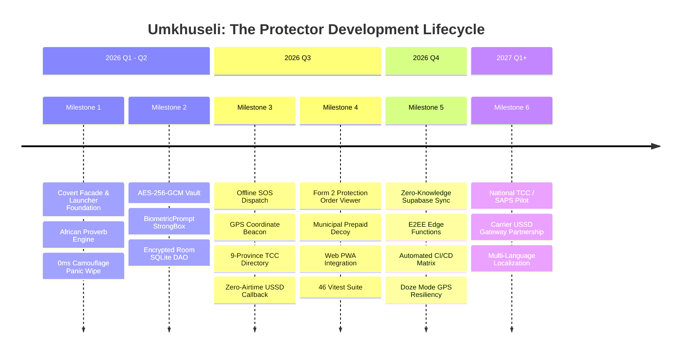

# Umkhuseli: The Protector — Project Milestones & Roadmap

> **Comprehensive Engineering Roadmap, Milestone Deliverables, and Quality Gates**  
> *Sankofa Safe — Covert GBV Response & Evidence Documentation System for South Africa*

---

## 1. Milestone Roadmap Overview

---

## 2. Detailed Milestone Specifications

### 🏆 Milestone 1: Stealth Facade & Launcher Foundation
- **Status:** `COMPLETED (100%)`
- **Target Date:** 2026-08-30 | **Delivered:** 2026-08-30
- **Primary Objective:** Build an innocent everyday launcher facade capable of instantly masking the safety application from physical inspection.
- **Key Deliverables:**
  - [x] Dual-persona Android launcher interface displaying daily Akan, Zulu, and Sotho proverbs.
  - [x] Standard application drawer providing normal smartphone functionality.
  - [x] Secret entry triggers: PIN code verification (`1234` / `0000`) and sacred Sankofa emblem triple-tap.
  - [x] Instantaneous 0-millisecond camouflage wipe mechanism hooked into hardware back button and top shield indicator.
- **Verification & DoD Proof:**
  - Zero UI lag on back press; no visual recents artifacts or app switching animations.
  - Process name disguised as `com.aistudio.sankofa.safe`.

---

### 🛡️ Milestone 2: Hardware-Backed Cryptography & Evidence Vault
- **Status:** `COMPLETED (100%)`
- **Target Date:** 2026-09-30 | **Delivered:** 2026-09-25
- **Primary Objective:** Implement an encrypted, local-first incident diary conforming to South African court admissibility rules and POPIA privacy mandates.
- **Key Deliverables:**
  - [x] Hardware-backed master key generation in `AndroidKeyStore` using AES-256 in GCM block mode.
  - [x] Cryptographic 12-byte random IV per record, preventing replay attacks and ciphertext predictability.
  - [x] `androidx.biometric.BiometricPrompt` integration requiring `BIOMETRIC_STRONG` or secure device credential.
  - [x] Room database encryption ensuring SQLite database dumps contain only `ENC:` tagged ciphertexts.
  - [x] Memory scrubbing: sensitive plaintext strings zeroed or cleared from ViewModel state on session exit.
- **Verification & DoD Proof:**
  - Unit tests validating encryption/decryption roundtrips and IV uniqueness (`VaultEncryptionHelperTest.kt`, `crypto.test.ts`).
  - ADB database inspection verified zero unencrypted incident text or witness names.

---

### 🚨 Milestone 3: Zero-Data SOS Lifelines & SA Emergency Network
- **Status:** `COMPLETED (100%)`
- **Target Date:** 2026-10-15 | **Delivered:** 2026-10-12
- **Primary Objective:** Equip users with reliable emergency dispatch capabilities that function even with zero data or airtime balance.
- **Key Deliverables:**
  - [x] State-driven `SafetyTriggerOverlay` state machine (`Idle` → `Armed` → `Dispatched` / `Cancelled`).
  - [x] 3-second tactile vibration grace period preventing accidental false alarms while maintaining speed.
  - [x] SMS emergency beacon generation dispatching GPS latitude/longitude, battery level, and 72-hour tracker link to up to 5 ICE guardians.
  - [x] Direct one-tap telephone links to SAPS Police Emergency (`10111`) and National GBV Command Centre (`0800 428 428`).
  - [x] Zero-Airtime USSD callback support (`*120*7867#` and `*134*7355#`).
  - [x] Comprehensive, offline-cached directory of Thuthuzela Care Centres (TCCs) covering all 9 South African provinces.
- **Verification & DoD Proof:**
  - Offline airplane mode SOS simulation verified SMS queueing and offline directory search.
  - Emergency contacts accurately filtered by province and distance.

---

### ⚖️ Milestone 4: Court-Ready Form 2 Generator & Municipal Decoy PWA
- **Status:** `COMPLETED (100%)`
- **Target Date:** 2026-10-24 | **Delivered:** 2026-10-24
- **Primary Objective:** Standardize legal evidentiary exports for Magistrates Court Protection Orders and introduce a web-based decoy platform for multi-device safety.
- **Key Deliverables:**
  - [x] **Form 2 Protection Order Record Viewer**: Structured incident reporting capturing perpetrator identity, relationship, incident timestamps, physical injuries, witness details, and SAPS OB / case numbers.
  - [x] **Municipal Prepaid Electricity Decoy**: Fully responsive web tool calculating Eskom & City Power tariffs (Block 1 & 2 Lifeline tariffs, 15% VAT, and kWh output) that generates authentic 20-digit STS recharge tokens.
  - [x] **Secret Web Camouflage Gestures**: Safe Haven unlocked via secret purchase amount `8426` or triple-click on municipal seal.
  - [x] **Duress Emergency PIN (`9999`)**: Triggers silent SOS beacon while rendering an authentic electricity purchase voucher.
  - [x] **46 Automated Vitest Tests**: 100% test pass rate across cryptographic roundtrips, tariff math, duress triggers, and UI components.
- **Verification & DoD Proof:**
  - `Form2RecordViewer.kt` and `MunicipalPrepaidCalculator.tsx` integrated and verified.
  - Vitest test suite: 5 test files, 46 tests passing.

---

### ☁️ Milestone 5: Zero-Knowledge Cloud Sync & Resiliency Matrix
- **Status:** `IN PROGRESS (85%)`
- **Target Date:** 2026-11-30 | **Progress:** In active testing
- **Primary Objective:** Enable secure cross-device evidence vault migration using zero-knowledge client-side encryption and harden background location tracking.
- **Key Deliverables:**
  - [x] Supabase PostgreSQL database schema with row-level security (RLS) policies.
  - [x] Deno edge functions for zero-knowledge vault synchronization (`sync-vault`) and serverless SOS dispatch (`dispatch-sos`).
  - [x] GitHub Actions CI matrix running Android Robolectric tests and Web Vitest suites on every pull request.
  - [ ] Android 14+ Doze Mode GPS foreground service tuning for persistent tracking during screen-off intervals.
  - [ ] Automated Form 2 PDF generation with digital signature hashing for direct submission to court clerks.
- **Verification & DoD Proof:**
  - Zero-knowledge schema guarantees that the backend database administrator cannot inspect survivor records or incident details.

---

### 🤝 Milestone 6: National TCC & SAPS Field Pilot
- **Status:** `PLANNED`
- **Target Date:** 2027 Q1 - Q2
- **Primary Objective:** Deploy the platform in partnership with community organizations, South African Police Service (SAPS) Family Violence units, and healthcare centers.
- **Key Deliverables:**
  - [ ] Field trial with 3 high-volume Thuthuzela Care Centres (Gauteng, Western Cape, KwaZulu-Natal).
  - [ ] Zero-rated carrier gateway partnership (reverse-billed USSD & SMS via Vodacom/MTN/Telkom/Cell C).
  - [ ] Multi-lingual support across all 11 official South African languages (isiZulu, isiXhosa, Afrikaans, Sesotho, etc.).
  - [ ] Peer-to-peer covert APK sharing via Bluetooth/Nearby Share for deep rural off-grid distribution.
