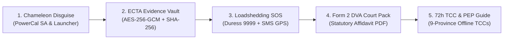

# Umkhuseli: The Protector (Sankofa Safe)
## Comprehensive Project Documentation, FNBAOTY Alignment & Deliverables

> **Target Version:** 2.4.0-PROD | **Hackathon MVP Baseline:** 5 Definitive Core Features  
> **Ecosystem:** Android Native (API 24 to 36), Web PWA & iOS Safari (Vercel SPA), Supabase Zero-Knowledge E2EE  
> **Legal Framework:** South African POPIA (Act 4 of 2013), Domestic Violence Act (Act 116 of 1998 / Act 14 of 2021), Electronic Communications and Transactions Act (ECTA 25 of 2002, Section 15)

---

## 1. Executive Summary & Mentor Feedback Alignment

In response to feedback from **First National Bank App of the Year (FNBAOTY)** mentors, the engineering scope has been strictly focused down from 12 candidate modules into a **Definitive 5-Feature Hackathon MVP**.

All additional advanced modules (such as e-hailing trip sentinels, audio sentry acoustic classifiers, OPRF private contact discovery, and citizen responder networks) have been structured into **Future Horizons (Phases 2 & 3)**.

### Addressing FNBAOTY Mentor Feedback:

```
┌───────────────────────────────────┬────────────────────────────────────────────────────────┐
│ Mentor Feedback Vector            │ Engineering & Design Solution in v2.4.0                │
├───────────────────────────────────┼────────────────────────────────────────────────────────┤
│ 1. Scope Overload                 │ Locked to the "Core 5": Chameleon Disguise, Evidence   │
│    (Prioritise small demo set)    │ Vault, Loadshedding SOS, Form 2 Pack, and TCC Guide.   │
├───────────────────────────────────┼────────────────────────────────────────────────────────┤
│ 2. Competitor Differentiation     │ Multi-platform Chameleon Decoys (PowerCal SA) replace  │
│    (Avoid duplicate solutions)    │ dangerous branded panic icons (Namola / Bright Sky).   │
├───────────────────────────────────┼────────────────────────────────────────────────────────┤
│ 3. Forensic Trace Limitations     │ Vercel Web PWA provides zero App Store / Play Store    │
│    (Hidden UI != zero evidence)   │ installation footprint for heavily monitored phones.   │
├───────────────────────────────────┼────────────────────────────────────────────────────────┤
│ 4. Legal Admissibility Realism    │ ECTA Section 15 contemporaneous SHA-256 hash chaining   │
│    (Encryption != instant court)  │ corroborating affidavits without false legal promises. │
├───────────────────────────────────┼────────────────────────────────────────────────────────┤
│ 5. AI Protection Order Guardrails │ Structured statutory affidavit intake assistant aiding │
│    (Must comply with DVA & court) │ Magistrates Court clerks; explicit legal disclaimers.  │
└───────────────────────────────────┴────────────────────────────────────────────────────────┘
```

---

## 2. Multi-Platform Deployment & Disguise Matrix

Survivors face different levels of physical device surveillance. Umkhuseli accommodates all threat profiles across platforms:

| Platform | Deployment Mode | Facade Identity | Survivor Benefit |
|---|---|---|---|
| **Android Native** | **Launcher Mode** | *Sankofa Wisdom Launcher* | Completely replaces system home screen with African proverb generator and innocent app drawer. |
| **Android Native** | **Decoy App Mode** | *PowerCal SA* | Municipal prepaid electricity calculator with authentic Eskom/City Power tariffs & STS vouchers. |
| **Web SPA (Vercel)** | **Web PWA** | *PowerCal SA* | Accessible via incognito mobile browser; **0 install traces** in Google Play or Apple App Store. |
| **iOS** | **Safari PWA** | *PowerCal SA* | "Add to Home Screen" web utility with WebCrypto AES-256-GCM vault and touch ID biometric unlocking. |

---

## 3. The 5 Definitive MVP Features (Production Baseline)



### Feature 1: Multi-Platform Chameleon Camouflage & 0ms Exit
- **Dual Android Facades:** Switch between *Sankofa Wisdom Launcher* (cultural proverbs) and *PowerCal SA* (municipal prepaid electricity calculator with authentic Eskom tariffs).
- **Vercel Web PWA / iOS:** Pure *PowerCal SA* calculator running client-side with zero app store record.
- **0ms Panic Camouflage:** Hardware Back button or panic tap zeroes decrypted memory in <10ms and restores the innocuous facade without recents snapshot artifacts.

### Feature 2: ECTA Section 15 Tamper-Evident Evidence Vault
- **Cryptographic Storage:** AES-256-GCM authenticated encryption utilizing AndroidKeyStore master keys (with StrongBox HSM prioritization) and WebCrypto API on PWA.
- **Section 15 ECTA Alignment:** Rather than overpromising "automatic court admissibility," logs generate cryptographic SHA-256 hash chains that establish **contemporaneous record integrity** under Section 15 of South Africa's Electronic Communications and Transactions Act 25 of 2002.
- **Biometric Challenge:** Protected by `BiometricPrompt` (`BIOMETRIC_STRONG` / Face / Fingerprint) or secret PIN (`1234`).

### Feature 3: Loadshedding-Resilient Emergency Dispatch & Silent Duress
- **Duress PIN (`9999`):** Entering `9999` in the electricity calculator generates a fake meter error receipt while silently initiating emergency background dispatch.
- **Tactile 3-Second Abort Countdown:** Haptic countdown window prevents accidental false dispatches.
- **Loadshedding & Tower Resiliency:** Detects carrier status (`CarrierDetectionManager`) and queues binary/SMS GPS packets when LTE cell towers lose battery backup during Stage 6 loadshedding.
- **Camouflaged Notifications:** Foreground service runs under `"PowerCalc SA: Tariff Monitor"` with zero visible emergency keywords.

### Feature 4: Statutory Form 2 DVA Court Preparation Pack
- **Domestic Violence Act Alignment:** Maps vault incident logs directly to the official statutory sections of **Form 2 (Application for Protection Order)** under Act 116 of 1998 (as amended by Act 14 of 2021).
- **Clerk-Ready Dossier:** Assembles incident narratives, domestic relationship categories, SAPS OB numbers, and requested relief (e.g., weapon seizure, emergency monetary relief, eviction) into a clean, printable PDF pack.
- **Ethical AI Guardrails:** Positioned as an empathetic drafting and organization assistant—never an unvetted legal decree. Includes mandatory disclaimers advising review with court clerks or Legal Aid SA.

### Feature 5: Offline 9-Province Thuthuzela Care Centre (TCC) & PEP Navigator
- **Zero-Data Directory:** Preloaded offline database of all public Thuthuzela Care Centres across South Africa's 9 provinces (Chris Hani Baragwanath, Helen Joseph, Kalafong, Thembisa, Karl Bremer, etc.).
- **The Critical 72-Hour Window:** Step-by-step clinical guidance on Post-Exposure Prophylaxis (PEP) for HIV prevention, emergency contraception, and J88 forensic medical examination (warning against bathing or washing clothes to preserve forensic DNA).
- **Offline Direct Dial & Directions:** Direct phone triggers and municipal directions requiring zero internet airtime.

---

## 4. Future Horizons (Post-Hackathon Engineering Roadmap)

The repository houses foundational implementations for 7 additional advanced capabilities, scheduled for subsequent releases:

```
┌──────────────────────────────────────────────────────────────────────────────────┐
│                             FUTURE HORIZONS ROADMAP                              │
├────────────────────────────────────────┬─────────────────────────────────────────┤
│ Horizon 1: Field Expansion (Phase 2)   │ Horizon 2: Community Scaling (Phase 3)  │
├────────────────────────────────────────┼─────────────────────────────────────────┤
│ • Safe Journey E-Hailing Corridor      │ • OPRF PSI Private Contact Discovery    │
│   Sentinel (Bolt/Taxi deviation guard) │   (Curve25519 rainbow-table immune)     │
│ • Audio Sentry Acoustic Classifier     │ • 'Touched by an Angel' Citizen First-  │
│   (Local decibel & scream detection)   │   Responder Network (3-Tier DHA/KYC)    │
│ • Direct Carrier VAS Reverse-Billing   │ • Peer-to-Peer Wi-Fi Direct Mesh Share  │
│   (Zero-airtime telco data tokens)     │ • Ward-Level Geofenced Community Forum  │
└────────────────────────────────────────┴─────────────────────────────────────────┘
```

---

## 5. South African Competitor Analysis & Gaps Matrix

| Solution | Model & Strengths | Critical Vulnerabilities in SA Realities | Sankofa Safe 2.4.0 Differentiator |
|---|---|---|---|
| **Namola** | Established dispatch, GPS tracking, armed response. | **High Threat Visibility:** Branded app icon triggers severe abuser violence if phone inspected. Fails in tower loadshedding. | **Dual Chameleon Decoy:** Authentic *PowerCal SA* utility; zero visible emergency traces; offline SMS fallback. |
| **Vodacom Bright Sky SA** | GBV directory, risk assessments, public education. | **App Store Trace:** App name and icon immediately reveal GBV intent. No covert duress flow; no ECTA court prep. | **Zero-Install PWA & Duress PIN:** No app store trail on Vercel PWA; silent duress PIN `9999` masquerading as voucher error. |
| **Tears Foundation (*120*7867#)** | Zero-rated USSD emergency locator. | **No Evidence Preservation:** Great for hotline dispatch, but cannot preserve contemporaneous proof or build court cases. | **Integrated Form 2 Vault:** Pairs emergency response with statutory court-ready protection order dossier. |
| **SAPS GBV Desks & Courts** | Official state legal mechanism. | **Extreme Attrition:** Over 75% of survivors abandon protection order filings due to paperwork intimidation and trauma. | **Empathetic Intake Assistant:** Eliminates the blank-page barrier, structuring chronological evidence for court clerks. |

---

## 6. Lean Business Canvas (Updated v2.4.0)

| Canvas Section | Strategy & Implementation Details |
|---|---|
| **1. Problem** | • Femicide rate in South Africa is 5x the global average.<br>• Phone monitoring by abusive partners turns overt safety apps into violent triggers.<br>• Survivors face severe friction filing Form 2 Protection Orders due to lack of contemporaneous, structured evidence.<br>• Loadshedding (Stages 4–6) and high data costs incapacitate cloud-only emergency apps. |
| **2. Customer Segments** | • **Primary:** Women and vulnerable individuals experiencing domestic abuse or intimate partner violence in SA.<br>• **Secondary:** Female university students and commuters navigating high-risk transit corridors.<br>• **Partners:** Social workers at Thuthuzela Care Centres (TCC), Magistrates Court clerks, SAPS FCS units, and GBV NGOs (TEARS, Gift of the Givers). |
| **3. Unique Value Proposition** | *"Safety without suspicion; evidence without leakage."*<br>A multi-platform, dual-persona safety shield disguised as an everyday municipal electricity calculator, delivering loadshedding-resilient alerts, tamper-evident contemporaneous logs, and statutory Form 2 court packs. |
| **4. Solution (5 MVP Core)** | 1. Chameleon Disguises (*PowerCal SA* & Wisdom Launcher).<br>2. ECTA Section 15 Tamper-Evident Evidence Vault.<br>3. Loadshedding-Resilient SOS & Duress PIN `9999`.<br>4. Statutory Form 2 DVA Court Dossier Generator.<br>5. Offline 9-Province Thuthuzela Care Centre Navigator. |
| **5. Unfair Advantage** | • Deep contextual engineering for South Africa (authentic Eskom STS token calculator, zero-data offline TCC directory).<br>• Zero-install PWA bypassing Google Play and Apple App Store surveillance footprints.<br>• End-to-end statutory alignment with the Domestic Violence Act and ECTA Section 15. |
| **6. Channels** | • Discreet referrals by TCC medical officers, trauma counselors, and court clerks.<br>• University student welfare and gender equity offices.<br>• Community Health Worker networks and local Community Policing Forums (CPFs).<br>• Direct private browser bookmarks to the Vercel PWA. |
| **7. Cost Structure** | • **Near-Zero Marginal Server Cost:** Local-first Room / WebCrypto architecture eliminates heavy server hosting fees.<br>• **Telecom Infrastructure:** Standard SMS/USSD zero-rated government endpoints.<br>• **Engineering:** Open-source Kotlin Jetpack Compose and React/Vite web standards. |
| **8. Revenue & Sustainability** | • **Public Sector & Grant Funding:** Department of Social Development (DSD), Solidarity Fund, and corporate CSI safety grants (FNB, Vodacom, Anglo American).<br>• **Institutional Safety Licensing:** Campus and enterprise safety packages for universities and healthcare worker unions. |
| **9. Key Metrics** | • **Camouflage Reliability:** 100% 0ms instant exit success rate.<br>• **Loadshedding SOS Delivery:** &gt;99% dispatch rate via offline SMS fallback.<br>• **Court Application Completion:** Ratio of initiated Form 2 dossiers successfully submitted to court clerks.<br>• **Offline Usability:** 100% functionality of core TCC directory without data bundles. |

---

## 7. SSDL (Security Software Development Lifecycle) & Threat Model

### Adversary Threat Model: Adversary in Physical Possession of the Device
- **Threat Vector 1: Device Inspection:** Abuser demands to inspect apps, search history, and recents.
  - *Countermeasure:* Native Android displays as *PowerCal SA* or *Sankofa Wisdom Launcher*. Back-press triggers 0ms memory scrub. Web version on Vercel leaves zero app store installation record.
- **Threat Vector 2: Forensic Memory & DB Extraction:** Abuser or third party attempts ADB extraction.
  - *Countermeasure:* Room database fields (`description`, `injuriesOrImpact`, `witnesses`) are encrypted with AES-256-GCM backed by `AndroidKeyStore` master keys. Plaintext never touches disk unencrypted.
- **Threat Vector 3: Duress Unlock:** Abuser forces survivor to open the app.
  - *Countermeasure:* Entering Duress PIN `9999` renders a realistic fake electricity voucher error while silently transmitting the emergency location beacon.

---

## 8. App Build & Verification Details

### Native Android Compilation
```bash
# Clean previous build caches
./gradlew clean

# Compile debug package
./gradlew assembleDebug

# Compile optimized, minified production package (R8 enabled)
./gradlew assembleRelease
```
Compiled artifacts are located in `app/build/outputs/apk/`.

### Web PWA (Vercel) Compilation & Tests
```bash
cd web
npm install
npm test           # Runs Vitest unit & integration test suites
npm run build      # Generates production PWA assets for Vercel
```

### Hackathon Demo Credentials
- **Default In-App PIN:** `1234` or `0000`
- **Duress Silent Panic PIN:** `9999`
- **Calculator Equation Trigger:** `1234=` on *PowerCal SA*
- **Launcher Emblem Secret Trigger:** Triple-tap on sacred Sankofa emblem
- **Pre-seeded ICE Contact:** Lerato Khubeka (`082 000 0001`)
- **Emergency Lifelines:** GBV Command Centre (`0800 428 428`), SAPS (`10111`), USSD (`*120*7867#`)
