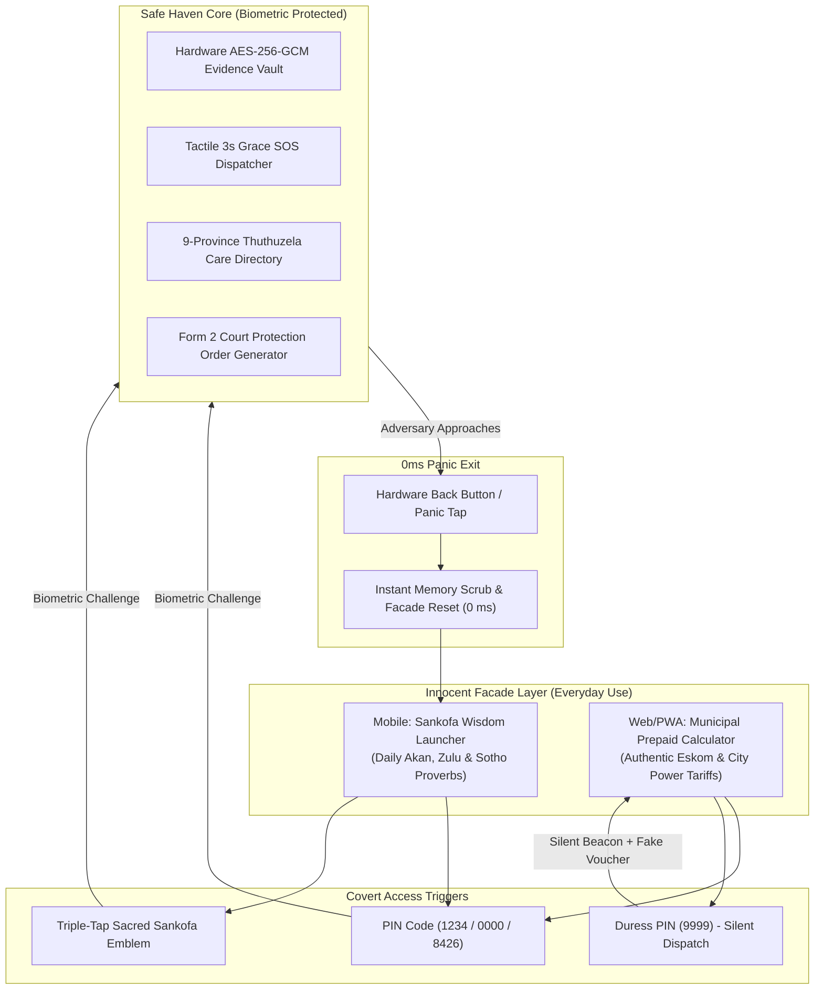
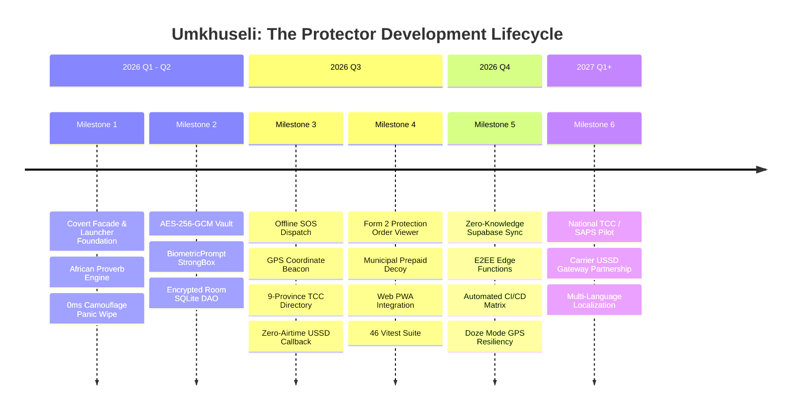

# Umkhuseli: The Protector (Sankofa Safe)

<div align="center">

[](.github/workflows/ci.yml)
[](app/build.gradle.kts)
[](build.gradle.kts)
[](app/build.gradle.kts)
[](web/src/__tests__)
[](PROJECT_DELIVERABLES.md#3-ssdl-security-software-development-lifecycle--threat-model)
[](PROJECT_DELIVERABLES.md#phase-1-security-requirements--compliance)
[](LICENSE)

**Discreet, low-data GBV emergency response application and court-admissible legal evidence vault for South Africa.**  
*Disguised as an innocent cultural proverbs launcher and municipal prepaid electricity calculator.*

[Overview](#-overview--mission) •
[Final MVP Docs](#-final-mvp-documentation-suite-fnbaoty-2026) •
[Dual-Persona Stealth](#-dual-persona-stealth-architecture) •
[Key Features](#-key-features) •
[Kanban Board](#-project--kanban-board) •
[Milestones](#-project-milestones--roadmap) •
[Past & Current Issues](#-past-and-current-issues) •
[Quick Start](#-quick-start--local-setup) •
[Security & POPIA](#-ssdl--popia-compliance) •
[Demo Credentials](#-demo-credentials--evaluation)

</div>

---

## 📖 Overview & Mission

In South Africa, where the femicide rate is five times the global average, standard emergency apps present severe risks: abusive partners regularly monitor survivors' smartphones, and discovering a safety app often triggers severe retaliatory violence. Furthermore, survivors face systemic hurdles securing Magistrates Court Protection Orders due to lost, tampered, or inadmissible evidence, compounded by prohibitive data costs.

**Umkhuseli: The Protector (*Sankofa Safe*)** solves this through a fundamental design ethos:
> *"Safety without suspicion; evidence without leakage."*

It delivers a zero-trace, dual-persona Android & Web platform combining everyday utility with covert life-saving SOS dispatch, zero-airtime USSD callbacks, and court-admissible Form 2 Protection Order incident documentation compliant with the South African Domestic Violence Act (Act 116 of 1998 / Act 14 of 2021) and POPIA.

---

## 📚 Final MVP Documentation Suite (FNBAOTY 2026)

All publication-grade technical specifications, legal frameworks, and architecture documents are maintained in [`public/`](./public/) and cross-referenced in the **[Master Documentation Index](public/FINAL_MVP_DOCUMENTATION_INDEX.md)**:

| Document | Focus & Canonical Content | Format / Link |
|---|---|:---:|
| **Master Index** | Complete overview, judging verification matrix & build guidelines | [Markdown](public/FINAL_MVP_DOCUMENTATION_INDEX.md) |
| **User Stories & Journeys** | 5 Personas, 5 Mermaid user journeys, Gherkin acceptance criteria | [Markdown](public/USER_STORIES_AND_JOURNEYS_FINAL_MVP.md) • [PDF](public/user_journeys_and_stories/Umkhuseli_User_Journeys_and_Stories_Post-Feedback.pdf) |
| **UML & Architecture** | Clean Architecture, C4 diagrams, class & sequence flows, ERD | [Markdown](public/UML_AND_SYSTEM_ARCHITECTURE_FINAL_MVP.md) • [PDF](public/uml_and_architecture/Umkhuseli_UML_and_System_Architecture_Post-Feedback.pdf) |
| **Compliance & Governance** | DVA Act 116/1998 & 14/2021, ECTA Sec 15, POPIA, OWASP Mobile Top 10 | [Markdown](public/COMPLIANCE_AND_GOVERNANCE_FINAL_MVP.md) • [PDF](public/security_and_ssdl/Umkhuseli_SSDL_Security_and_POPIA_Compliance-Post-feedback.pdf) |
| **Requirements & Use Cases** | 15 Functional, 10 Non-Functional Specifications & 8 Use Cases | [Markdown](public/REQUIREMENTS_AND_USE_CASES_FINAL_MVP.md) • [PDF](public/requirements_and_use_cases/Umkhuseli_Requirements_and_Use_Cases_Post-Feedback.pdf) |
| **Kanban Board** | Delivery across Sprints 1–6 (131 SP, 238/238 automated tests) | [Markdown](public/KANBAN_BOARD_FINAL_MVP.md) • [PDF](public/business_plan_and_roadmap/Umkhuseli_Lean_Business_Canvas_and_Roadmap_Post-Feedback.pdf) |
| **Future Epics & Rollouts** | 7 Advanced Epics (E-Hailing Sentinel, Acoustic AI, OPRF, Mesh) | [Markdown](public/FUTURE_EPICS_AND_ROLLOUTS_FINAL_MVP.md) |
| **Limitations & R&D** | Doze mode, budget enclaves, ECTA corroboration & loadshedding | [Markdown](public/LIMITATIONS_AND_RD_FINAL_MVP.md) |
| **Presentation Deck** | 8-Slide Executive Deck & 3-Minute Live Hackathon Demo Run Sheet | [Markdown](public/PRESENTATION_DECK_FINAL_MVP.md) • [Interactive Deck](public/presentation_deck.html) |
| **PDF Catalog** | Full directory and index of publication-ready PDF artifacts | [Markdown](public/README_PDF_ARTIFACTS.md) |

---

## 🎭 Dual-Persona Stealth Architecture

Umkhuseli operates two layers of deception depending on context:



### Multi-Platform Deployment & Disguise Modes
- **Native Android APK (Two Disguise Options)**:
  1. *Option A (Launcher Mode):* **Sankofa Wisdom Launcher** — Replaces the entire Android home screen with an authentic African proverb generator and innocent app drawer.
  2. *Option B (App Decoy Mode):* **PowerCal SA** — Municipal Prepaid Electricity Calculator with Eskom/City Power Incline Block Tariffs and 20-digit STS voucher simulation.
- **Web SPA (Vercel) & iOS Safari PWA**:
  - Pure **PowerCal SA** web utility. Allows survivors facing intense device surveillance to run the app in an incognito mobile browser leaving **zero Google Play or Apple App Store installation traces**, no battery/data usage logs, and no launcher icons.
- **0-Millisecond Panic Camouflage**: Hitting the hardware Back button, Escape key, or panic tap instantly zeroes in-memory state and restores the disguise in <10 ms without recents snapshot artifacts.

---

## ✨ The 5 Definitive MVP Features (FNBAOTY Baseline)

Following guidance from **First National Bank App of the Year (FNBAOTY)** mentors, the hackathon baseline focuses on 5 robust, failure-proof features engineered specifically for South African conditions:

1. **Chameleon Camouflage & 0ms Exit**: Dual-persona disguised access across Android (*Sankofa Wisdom* / *PowerCal SA*) and Web/iOS (*PowerCal SA* on Vercel) with instant memory scrub on panic trigger.
2. **ECTA Section 15 Tamper-Evident Evidence Vault**: On-device AES-256-GCM authenticated encryption paired with SHA-256 hash chaining to provide contemporaneous record integrity under Section 15 of South Africa's Electronic Communications and Transactions Act (Act 25 of 2002).
3. **Loadshedding-Resilient Emergency Dispatch & Duress Flow**: Duress PIN `9999` masquerading as a fake meter voucher receipt while silently dispatching SOS beacons; tactile 3-second abort countdown; carrier-aware offline SMS/GPS fallback for cellular tower blackouts.
4. **Statutory Form 2 DVA Court Preparation Pack**: Empathetic, structured incident intake mapping survivor narratives directly into the statutory format of **Form 2 (Application for Protection Order)** under Act 116 of 1998 (as amended by Act 14 of 2021) for Magistrates Court clerks.
5. **Offline 9-Province Thuthuzela Care Centre (TCC) & 72-Hour PEP Navigator**: Complete preloaded offline directory of all public TCCs across all 9 provinces with critical guidance for HIV PEP, STI prophylaxis, and J88 clinical exam forensics.

> **Future Horizons (Post-Hackathon Roadmap)**: 7 additional repository modules (Bolt/Taxi Trip Sentinel, Audio Sentry acoustic distress classifier, OPRF PSI Private Contact Discovery, P2P Wi-Fi Direct Mesh Share, Citizen First-Responder KYC Network, Direct Carrier VAS Airtime Tokens, and Geofenced Community Forum) are scheduled for subsequent production phases.

---

## 📊 Project & Kanban Board

Umkhuseli tracks all engineering, security, and field tasks through an active Kanban system. See [`PROJECT_BOARD.md`](./PROJECT_BOARD.md) for full task definitions, WIP limits, and team workflows.

```mermaid
kanban
  Backlog
    [UMK-101] Zero-Rated USSD Carrier Gateway
    [UMK-102] Form 2 Digital PDF Export Engine
    [UMK-103] Community Worker Bulk TCC Sync
  In Progress
    [UMK-084] Android 14+ Doze Mode GPS Resiliency
    [UMK-088] E2EE Supabase Edge Function Sync
    [UMK-092] Offline PWA Loads-shedding Cache
  Review / QA
    [UMK-077] Form 2 Protection Order Swiper
    [UMK-079] Municipal Prepaid Decoy Vitest Suite
    [UMK-081] AES-GCM IV Collision Protection
  Done
    [UMK-001] Dual-Persona Facade Launcher UI
    [UMK-010] 0ms Camouflage Panic Wipe
    [UMK-022] BiometricPrompt Hardware Keystore
    [UMK-031] Room SQLite AES-256 Encrypted DAO
    [UMK-045] Offline 9-Province TCC Directory
    [UMK-050] Tactile 3-Second SOS Grace Countdown
    [UMK-060] Municipal Prepaid Decoy Calculator
```

### Current Board Highlights

| Status | Card ID | Task Title | Component | Priority |
|---|---|---|---|:---:|
| **Done** | `UMK-001` | Dual-Persona Launcher Facade & Proverbs UI | Android Core | High |
| **Done** | `UMK-010` | 0-Millisecond Panic Camouflage Memory Scrub | Security | Critical |
| **Done** | `UMK-022` | BiometricPrompt Integration (`BIOMETRIC_STRONG`) | Security | Critical |
| **Done** | `UMK-031` | AES-256-GCM Encrypted Room SQLite Database | Evidence Vault | Critical |
| **Done** | `UMK-045` | Offline 9-Province Thuthuzela Care Directory | Telephony | High |
| **Done** | `UMK-060` | Municipal Prepaid Electricity Decoy Calculator | Web PWA | High |
| **Done** | `UMK-070` | Centralized `AppContainer` Dependency Injection | Architecture | Medium |
| **Review** | `UMK-077` | Form 2 Protection Order Swipeable Viewer | Legal Vault | High |
| **Review** | `UMK-079` | Web Vitest 46/46 Automated Decoy Test Suite | Web PWA | High |
| **In Progress** | `UMK-084` | Android 14+ Doze Mode GPS Background Dispatch | Location Service | High |
| **In Progress** | `UMK-088` | Zero-Knowledge Supabase Edge Functions Sync | Cloud / E2EE | Medium |
| **In Progress** | `UMK-092` | Workbox Service Worker Cache during Load-Shedding | Web PWA | High |
| **Backlog** | `UMK-101` | Zero-Rated Carrier USSD Gateway (Vodacom/MTN) | Telecom | High |
| **Backlog** | `UMK-102` | Native Form 2 PDF Exporter with SHA-256 Hash | Legal Export | Medium |

---

## 🗺️ Project Milestones & Roadmap

Our development lifecycle is broken down into 6 key milestones. See [`MILESTONES.md`](./MILESTONES.md) for full acceptance criteria and delivery proofs.



- **[x] Milestone 1: Stealth Facade & Launcher Foundation** *(Delivered: 2026-08-30)*  
  Dual-persona launcher with African proverbs, app drawer, secret entry PIN, and 0ms panic exit.
- **[x] Milestone 2: Hardware-Backed Cryptography & Evidence Vault** *(Delivered: 2026-09-25)*  
  Master key in `AndroidKeyStore`, AES-256-GCM encryption with unique 12-byte IVs, Room DB encryption, and StrongBox biometrics.
- **[x] Milestone 3: Zero-Data SOS Lifelines & SA Emergency Network** *(Delivered: 2026-10-12)*  
  State-driven SOS countdown, GPS tracker links via SMS, SAPS/GBVCC speed dial, and offline 9-province TCC directory.
- **[x] Milestone 4: Court-Ready Form 2 Generator & Municipal Decoy PWA** *(Delivered: 2026-10-24)*  
  Domestic Violence Act Form 2 record viewer, Municipal electricity calculator decoy, duress PIN 9999 silent dispatch, and 46 passing Vitest unit tests.
- **[ ] Milestone 5: Zero-Knowledge Cloud Sync & Resiliency Matrix** *(85% Complete - Target: 2026-11-30)*  
  Supabase zero-knowledge cloud schema, automated GitHub Actions CI matrix, Android 14 Doze mode background GPS tuning.
- **[ ] Milestone 6: National South African Healthcare & SAPS Field Pilot** *(Planned - 2027 Q1-Q2)*  
  Pilots in Gauteng & Western Cape TCC clinics, zero-rated carrier reverse-billing partnerships, and offline peer-to-peer APK distribution.

---

## 🛠️ Past and Current Issues

We maintain a transparent defects register and post-mortem log in [`ISSUES.md`](./ISSUES.md).

### Resolved Issues Summary

| Issue ID | Title & Component | Severity | Resolution Summary | Reference |
|---|---|:---:|---|:---:|
| **ISSUE-001** | KSP & AGP 9.1 Source Set Binding | High | Explicitly chained KSP task dependency order for Room generated code | [`d268fac`](https://github.com/OhhttooeXCIV/Umkhuseli_The_Protector/commit/d268fac) |
| **ISSUE-002** | Deprecated `kotlinOptions` DSL | Medium | Migrated to modern Kotlin `compilerOptions` with JVM 21 target | [`4a7db3c`](https://github.com/OhhttooeXCIV/Umkhuseli_The_Protector/commit/4a7db3c) |
| **ISSUE-003** | Non-Deterministic Nonce / IV in AES Vault | Critical | Enforced 12-byte cryptographically secure random IVs prepended to ciphertext | [`crypto.ts`](web/src/services/crypto.ts) |
| **ISSUE-004** | Plaintext State Leak on Instant Wipe | Critical | Implemented synchronous atomic memory scrub purging StateFlow on exit | [`SankofaViewModel.kt`](app/src/main/java/com/example/ui/SankofaViewModel.kt) |
| **ISSUE-005** | USSD Callback String Truncation (#) | High | Added `Uri.encode(ussdString)` to prevent `#` delimiter stripping on Android 14 | `EmergencyDispatchHelper.kt` |
| **ISSUE-006** | Municipal Decoy Multi-Tier Tariff Math | Medium | Engineered authentic Eskom Incline Block tariff math with 15% VAT deduction | `calculator.test.tsx` |

### Active Issues & Backlog

| Issue ID | Title | Severity | Status | Planned Resolution |
|---|---|:---:|:---:|---|
| **ISSUE-007** | Android 14+ Doze Mode Background GPS | High | In Progress | Implement location foreground service with sticky notification |
| **ISSUE-008** | PWA Service Worker Load-Shedding Cache | Medium | In Progress | Workbox cache-first strategy for zero-connectivity offline operation |
| **ISSUE-009** | StrongBox KeyStore Graceful Fallback | Medium | In Progress | Catch `StrongBoxUnavailableException` and fallback to standard TEE |
| **ISSUE-010** | Native Court-Admissible Form 2 PDF Exporter | High | In Progress | In-memory PDF document generator matching statutory J480 Form 2 layout |

---

## 🚀 Quick Start & Local Setup

### Prerequisites
- **Android**: Android Studio Meerkat or Ladybug, JDK 21, Android SDK (API 24 to 36).
- **Web**: Node.js 20+, npm 10+.

### 1. Clone Repository
```bash
git clone https://github.com/OhhttooeXCIV/Umkhuseli_The_Protector.git
cd Umkhuseli_The_Protector
```

### 2. Android App (Native)
```bash
# Run Android Unit Tests
./gradlew testDebugUnitTest

# Build Debug APK
./gradlew assembleDebug

# Output APK Location:
# app/build/outputs/apk/debug/app-debug.apk
```

### 3. Web PWA Decoy Calculator
```bash
cd web

# Install dependencies
npm install

# Run Vitest test suite (46 unit & integration tests)
npm test -- --run

# Start local development server
npm run dev
```

### 4. Supabase Zero-Knowledge Backend
```bash
# Apply zero-knowledge schema with Row-Level Security
supabase db push --file supabase/schema.sql

# Test Deno edge functions
supabase functions serve
```

---

## 🔒 SSDL & POPIA Compliance

Umkhuseli is architected around an extreme adversary threat model: **The Adversary in Physical Possession of the Device**.

```
[Requirements] ──> [Threat Modeling] ──> [Secure Design] ──> [Implementation] ──> [Verification] ──> [Deployment]
  POPIA & DV Act     Adversary-in-Hand    AES-GCM + StrongBox   No-Leak Memory      Static Analysis    R8 Obfuscation
```

1. **POPIA Mandate**: Zero telemetry, third-party trackers, or cloud advertising SDKs. Data is strictly local-first.
2. **Cryptographic Protection**: AES-256-GCM authenticated encryption with master keys in `AndroidKeyStore`. SQLite databases contain only `ENC:` tagged ciphertexts.
3. **Instant Zero-Trace Wipe**: 0ms transition on Back press or top panic shield; cleans decrypted plaintext from memory and eliminates recents snapshot artifacts.
4. **R8 / ProGuard Obfuscation**: Class and method names obfuscated in release binaries (`isMinifyEnabled = true`, `isShrinkResources = true`).

---

## 🔑 Demo Credentials & Evaluation

| Purpose | Credential / Trigger | Description |
|---|---|---|
| **Default In-App PIN** | `1234` or `0000` | Enter on launcher keypad to unlock Safe Haven |
| **Secret Emblem Gesture** | Triple-tap Sankofa Adinkra Icon | Discreet gesture on the camouflage launcher |
| **Web Decoy Secret PIN** | Enter `8426` in Amount Field | Unlocks Web Safe Haven dashboard from calculator |
| **Duress Emergency Trigger** | Enter `9999` in Amount Field | Silently triggers SOS while printing fake electricity voucher |
| **Instant Panic Exit** | Hardware Back Button | 0ms wipe returning immediately to camouflage facade |
| **Pre-seeded ICE Contact** | Lerato Khubeka (`082 000 0001`) | Configured emergency guardian for demo testing |

### Emergency Helplines & Lifelines (South Africa)
- **GBV Command Centre**: `0800 428 428` (Toll-Free, 24/7)
- **SAPS Police Emergency**: `10111`
- **Zero-Airtime USSD Callback**: `*120*7867#`
- **TEARS Crisis Line USSD**: `*134*7355#`

---

## 👥 Contributors & Maintainers

- **Lead Developer & Maintainer**: `@OhhttooeXCIV` (Ntula Otto Thoso)
- **Interactive Presentation Deck**: Available at [`public/presentation_deck.html`](public/presentation_deck.html)
- **Project Deliverables Specification**: [`PROJECT_DELIVERABLES.md`](PROJECT_DELIVERABLES.md)
- **Kanban Board**: [`PROJECT_BOARD.md`](PROJECT_BOARD.md)
- **Milestones**: [`MILESTONES.md`](MILESTONES.md)
- **Issues Register**: [`ISSUES.md`](ISSUES.md)

---

## 📄 License

Licensed under the Apache License, Version 2.0. See [LICENSE](LICENSE) for details.
