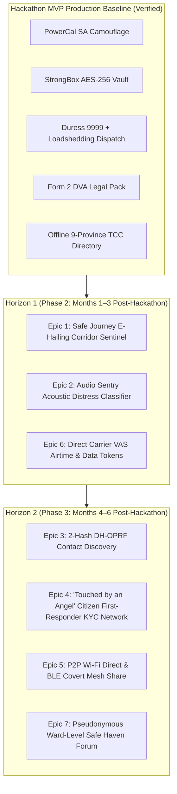
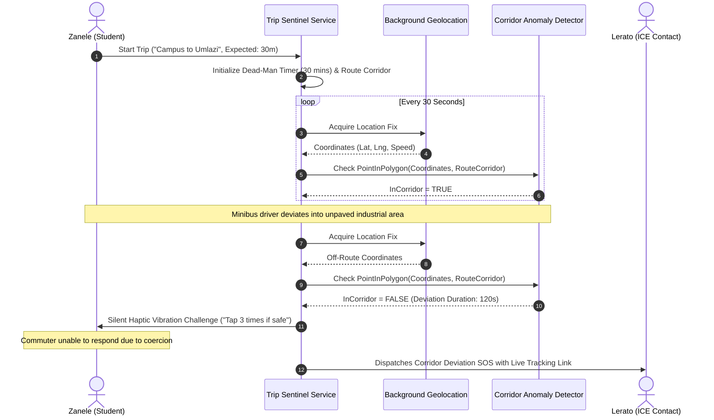
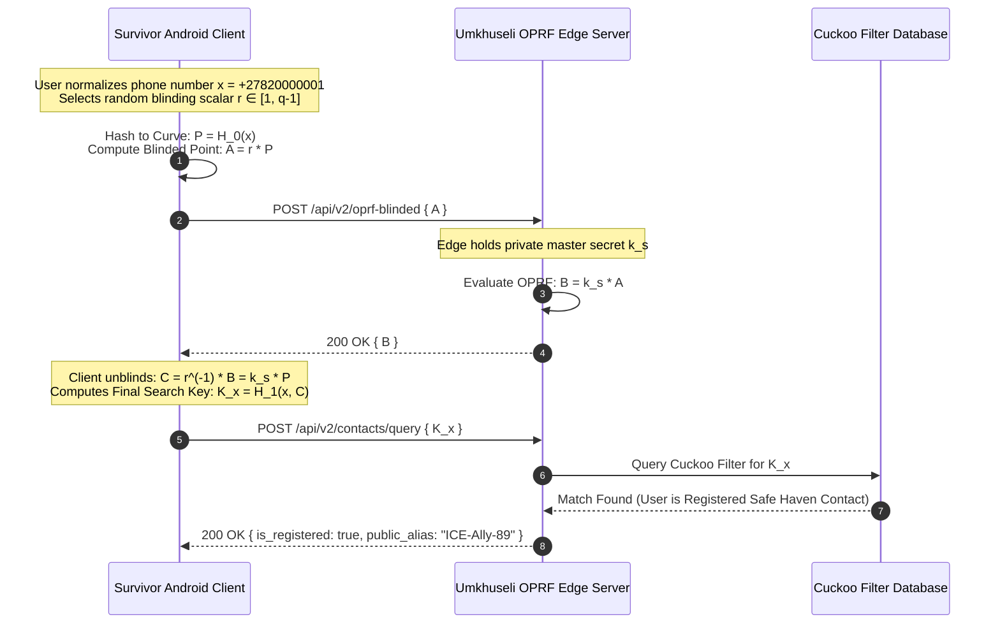
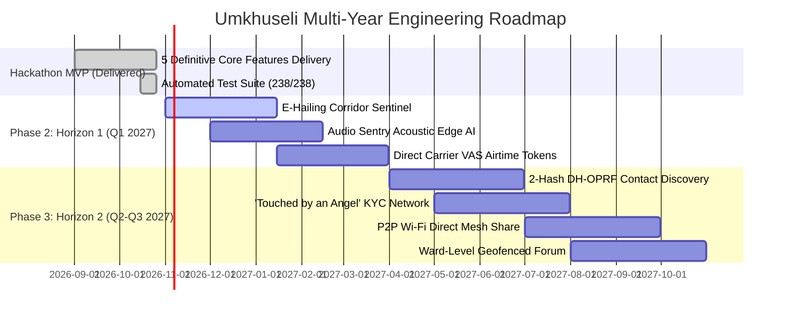

# Umkhuseli: The Protector — Future Epics, Post-Hackathon Milestones & Technology Roadmap
## FNB App of the Year (FNBAOTY) 2026 Hackathon Final MVP Deliverable

---

### Executive Summary

To deliver a completely stable, failure-proof demonstration for the **FNB App of the Year (FNBAOTY) 2026 Hackathon**, Umkhuseli intentionally focused on **5 Core MVP Features**:
1. *Chameleon Camouflage & 0-ms Exit*
2. *ECTA Section 15 Tamper-Evident Evidence Vault*
3. *Loadshedding-Resilient Emergency Dispatch & Duress PIN 9999*
4. *Statutory Form 2 DVA Court Preparation Pack*
5. *Offline 9-Province Thuthuzela Care Centre Directory & 72-Hour PEP Navigator*

This technical specification establishes the **Post-Hackathon Engineering Roadmap (2026–2027)**. It outlines the formal architectural, cryptographic, and operational specifications for **7 Advanced Epics** designed to scale Umkhuseli from an emergency personal tool into a nationwide community safety infrastructure across South Africa.

---

### Post-Hackathon Horizons Architecture Overview



---

### Epic 1: Safe Journey E-Hailing & Minibus Taxi Corridor Sentinel

#### 1.1 Problem & South African Context
Commuters—particularly young women and university students—face severe risks of abduction, robbery, and sexual assault when using e-hailing services (e.g., Bolt, Uber) or traversing informal minibus taxi corridors after dark. Traditional trip-sharing requires active internet connectivity and relies on passive monitoring by friends who may be asleep or distracted.

#### 1.2 Architectural Specification
The Corridor Sentinel introduces an **autonomous, low-power dead-man switch and path deviation detector**:
- **Expected Route Envelope**: Computes a dynamic geospatial bounding corridor using OpenStreetMap road vector segments between the pickup location and destination:
  $$\text{CorridorBuffer} = \text{RouteGeometry} \oplus \delta_{\text{buffer}} \quad (\text{where } \delta_{\text{buffer}} = 150\text{ meters})$$
- **Dead-Man Countdown Timer**: The user sets an expected transit duration (e.g., 25 minutes) with a 5-minute grace window. If the user fails to authenticate via covert gesture or PIN before timer expiry, an automated escalation sequence initiates.
- **Anomalous Deviation Trigger**: If device GPS coordinates fall outside $\text{CorridorBuffer}$ for $\ge 120\text{ seconds}$ without user acknowledgement, an automated **Corridor Deviation Alert** is dispatched to designated guardians.



---

### Epic 2: Audio Sentry Ambient Acoustic Distress Classifier

#### 2.1 Threat Vector & Privacy Safeguards
During violent home invasions or intimate assaults, survivors are often physically restrained or unable to touch their phone. However, continuous audio recording violates privacy, rapidly drains batteries, and violates POPIA.

#### 2.2 Edge AI Architecture & TensorFlow Lite Implementation
Umkhuseli’s **Audio Sentry** runs an ultra-lightweight, quantized convolutional neural network (**Edge Impulse / TensorFlow Lite Micro**, $<800\text{ KB}$) entirely on-device:
- **Zero-Storage Privacy Protocol**: Audio waveforms are sampled into a circular 5-second ring buffer in volatile memory. **No audio is ever written to disk or transmitted over the network.**
- **Acoustic Event Detection Classes**:
  1. *Human Screams / High-Pitch Vocal Distress*
  2. *Sudden Blunt Physical Impacts & Thuds*
  3. *Shattering Window Glass*
  4. *Aggressive Shouting / Male Vocal Aggression*
- **Inference Threshold & Confirmation Window**:
  $$\text{Trigger Condition}: \sum_{w=1}^{3} \mathbb{I}\left(P(\text{Scream} \mid \text{AudioFrame}_w) > 0.88\right) \ge 2$$
  Upon meeting this mathematical threshold, the system triggers the 3-second tactile SOS countdown. If not canceled, emergency dispatch fires automatically.

---

### Epic 3: 2-Hash DH-OPRF Private Set Intersection (PSI) Contact Discovery

#### 3.1 Problem: Rainbow Table Attacks on South African Phone Numbers
Standard contact discovery hashes address book numbers with SHA-256 and queries a server database. In South Africa, mobile numbers are strictly bounded to approximately 100 million valid MSISDNs (`+27 6x`, `+27 7x`, `+27 8x`). A domestic abuser or malicious actor can precompute a complete rainbow table of all 100 million hashes in **under 15 seconds**, deanonymizing every emergency contact and survivor on the platform.

#### 3.2 Cryptographic Protocol: 2-Hash DH-OPRF over Curve25519
To achieve mathematical privacy, Umkhuseli adopts a **2-Hash Diffie-Hellman Oblivious Pseudorandom Function (2Hash-DH-OPRF)**:



- **Mathematical Proof of Security**:
  - The Edge Server never receives $x$ or $H_0(x)$; it only sees the blinded point $A = r \cdot H_0(x)$, which is indistinguishable from random noise in Curve25519.
  - The Client cannot compute $K_x$ without the server's scalar $k_s$, making offline rainbow tables computationally impossible.

---

### Epic 4: 'Touched by an Angel' Vetted Citizen First-Responder KYC Network

#### 4.1 Concept & Community Police Forum (CPF) Alignment
In township environments and remote rural communities, formal SAPS response times can exceed 45 to 90 minutes. The **'Touched by an Angel' Network** mobilizes vetted community members, neighborhood watch coordinators, and trained community elders located within 500 meters of an active SOS incident.

#### 4.2 Security, Vetting & Zero-Knowledge Verification
- **Vetting Tier 1: SAPS Clearance & CPF Accreditation**: First responders must submit verified South African National ID documents and police clearance certificates via an accredited KYC verification pipeline.
- **Geofenced Anonymous Broadcast**: When a survivor triggers SOS, the cloud backend creates a dynamic PostGIS geofence:
  ```sql
  SELECT responder_id, push_token 
  FROM public.vetted_responders 
  WHERE ST_DWithin(current_location, ST_MakePoint(survivor_lng, survivor_lat)::geography, 750) 
    AND is_on_duty = TRUE 
    AND is_verified = TRUE;
  ```
- **Zero-Knowledge Identity Shielding**: The responder is directed to the scene with navigation vectors, but the survivor’s name, domestic history, and contact details are completely shielded to prevent vigilantism or secondary victimization.

---

### Epic 5: P2P Wi-Fi Direct & Bluetooth LE Covert Mesh Share

#### 5.1 Scenario: Total Infrastructure Grid & Telecommunications Collapse
During Stage 8 loadshedding scenarios or severe natural disasters, base station backup batteries are stolen or exhausted, causing total regional telecommunications collapse. In this environment, cloud-based SOS and webhooks fail completely.

#### 5.2 Delay-Tolerant Networking (DTN) Architecture
Umkhuseli implements an **ad-hoc peer-to-peer mesh synchronization engine** using **Wi-Fi Direct and Bluetooth Low Energy (BLE)**:
- **Covert Beaconing**: The device emits an innocuous BLE service advertisement mimicking standard Bluetooth smart accessories (e.g., fitness trackers or hearing aids).
- **Store-and-Forward Cryptographic Bundles**: An encrypted incident bundle or emergency beacon is signed and passed hop-by-hop between neighboring Umkhuseli installations using a Delay-Tolerant Networking protocol.
- **Opportunistic Egress**: When any mesh node subsequently connects to a functioning cellular tower or Wi-Fi hotspot, all accumulated emergency bundles are automatically uploaded to the central alert hub.

---

### Epic 6: Direct Carrier VAS Airtime & Emergency Data Token Purchase

#### 6.1 Socio-Economic Headwind: "Zero-Airtime Paralysis"
A primary impediment to emergency intervention in South Africa is prepaid airtime depletion. Over 75% of mobile users operate on prepaid plans, frequently maintaining a zero-credit balance. While USSD is reverse-billed, placing follow-up voice calls or accessing web navigation requires active airtime.

#### 6.2 Mobile Network Operator (MNO) Value-Added Services Integration
Umkhuseli partners with South Africa's four major MNOs (**Vodacom, MTN, Telkom, and Cell C**) via Direct Carrier Billing and VAS APIs:
- **Automated Emergency Airtime Disbursement**: When an authenticated SOS or Duress PIN is triggered, the Umkhuseli cloud backend invokes MNO provisioning endpoints:
  - *Vodacom Airtime Advance API*
  - *MTN MoMo / VAS Disbursement Gateway*
- **Reverse-Billed Data Bundles**: Automatically injects a 50 MB zero-balance emergency data bundle onto the survivor’s MSISDN, funded through corporate social investment (CSI) partnerships, enabling persistent GPS updates and VoIP communication.

---

### Epic 7: Pseudonymous Ward-Level Community Safe Haven Forum

#### 7.1 Localized Collective Intelligence
Survivors and community members require a safe platform to share localized safety alerts (e.g., unlit street corridors, gang activity at specific taxi ranks, broken municipal infrastructure) without fear of abuser retaliation or social stigmatization.

#### 7.2 Technical Implementation: H3 Hexagons & Rotating HMACs
- **Spatial Indexing**: Municipalities are indexed into Uber **H3 Hexagonal Hierarchical Spatial Indexes** at Resolution 8 (average hexagon area $\approx 0.737\text{ km}^2$, corresponding to neighborhood ward sizes).
- **Rotating Pseudonymous Identity**: To prevent cross-post tracking or abuser profiling, the user’s forum handle rotates automatically every calendar month:
  $$\text{ForumHandle} = \text{"Ally-" } \parallel \text{Truncate}_8\left(\text{HMAC-SHA256}(\text{UserMasterSalt}, \text{H3Index} \parallel \text{MonthYear})\right)$$
- **Quadratic Trust & Auto-Quarantine**: Posts require positive trust upvotes from verified local community members; any post receiving $\ge 3$ community flags is instantly moved to a quarantine buffer pending elder review.

---

### Multi-Year Technical Rollout Timeline (2026–2027)



---

### Partnership & Institutional Scaling Strategy

| Phase | Milestone Target | Key Strategic Partners | Regulatory Milestones |
|---|---|---|---|
| **Phase 1 (MVP)** | 5 Core Features on Android & Web PWA. | FNBAOTY, AWS / Vercel Open Source. | POPIA & ECTA Sec 15 compliance. |
| **Phase 2 (H1)** | 10,000 Active Commuter Sentinels; Carrier VAS. | Vodacom, MTN, Bolt, SANTACO. | ICASA VAS registration. |
| **Phase 3 (H2)** | 50,000 Users; 500 Vetted First Responders. | SAPS CPFs, DSD, Tears Foundation, POWA. | DOJCD National Form 2 Digital Filing Integration. |
