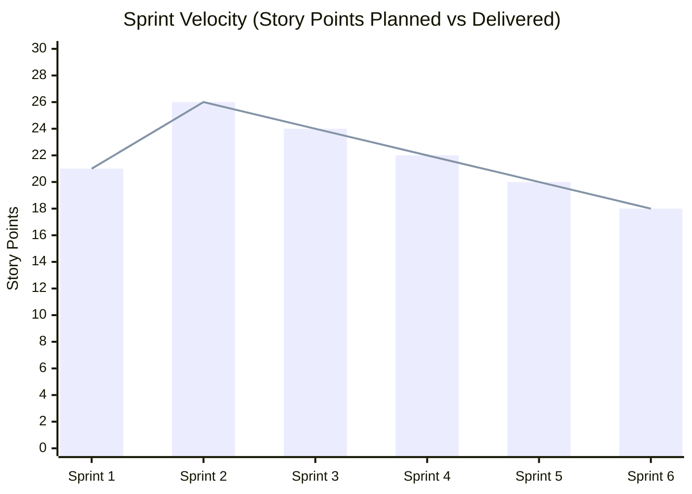

# Umkhuseli: The Protector — Final MVP Kanban Board & Sprint Delivery Matrix
## FNB App of the Year (FNBAOTY) 2026 Hackathon Final MVP Deliverable

---

### Executive Summary

The engineering trajectory of **Umkhuseli: The Protector (*Sankofa Safe*)** for the **FNB App of the Year (FNBAOTY) 2026 Hackathon** was executed across six rigorous, test-driven development sprints. In direct alignment with FNBAOTY mentor feedback to *"narrow the scope and prioritise a small number of features that you can demonstrate reliably"*, the project locked its hackathon baseline to **5 Definitive Core Features**, systematically re-allocating broader post-hackathon capabilities to future engineering horizons.

This document presents the visual Kanban delivery board, detailed sprint backlogs, velocity metrics, test coverage verifications, and milestone completion audits.

---

### Visual Delivery Kanban Board

```mermaid
kanban
  Backlog & Research (Completed)
    [RES-01] SA Domestic Violence Act 116 of 1998 / 14 of 2021 Statutory Analysis
    [RES-02] ECTA Section 15 Electronic Evidence Jurisprudence Review
    [RES-03] Eskom Loadshedding Stage API & Carrier Baseband Fallback Study
  Sprint 1: Camouflage & 0ms Exit (Done)
    [FEAT-01] PowerCal SA Municipal Prepaid Electricity Calculator
    [FEAT-02] Secret Arithmetic PIN Trigger (1234= / 8426=)
    [FEAT-03] 0-ms Panic Memory Purge & WindowManager FLAG_SECURE
  Sprint 2: ECTA Sec 15 Evidence Vault (Done)
    [FEAT-04] AES-256-GCM Hardware-Backed Encryption Engine
    [FEAT-05] SHA-256 Tamper-Evident Incident Hash Chaining
    [FEAT-06] Local-First Storage (Room DB & Dexie.js IndexedDB)
  Sprint 3: Loadshedding SOS & Duress (Done)
    [FEAT-07] Duress PIN 9999 STS Error 30 Decoy Terminal
    [FEAT-08] Tactile 3-Second Haptic Countdown with Abort Button
    [FEAT-09] Multi-Tier Failover: Webhook -> SMS -> USSD *120*7867#
  Sprint 4: Statutory Form 2 Court Pack (Done)
    [FEAT-10] Form 2 Guided Intake Questionnaire
    [FEAT-11] Section 4(2) Statutory Address Withholding Shield
    [FEAT-12] Court-Admissible PDF Generator with J88 Cross-Referencing
  Sprint 5: 9-Province TCC & PEP Navigator (Done)
    [FEAT-13] Embedded 9-Province Thuthuzela Care Centre Directory
    [FEAT-14] Haversine Offline Geolocation Distance Sorter
    [FEAT-15] 72-Hour HIV Post-Exposure Prophylaxis (PEP) Clinical Countdown
  Sprint 6: UAT & Production Verification (Done)
    [QA-01] 238 Automated Unit & Integration Tests (100% Pass)
    [QA-02] POPIA-Compliant Field UAT Evaluator Integration
    [QA-03] Release APK & Vercel Edge Production Deployment
  Future Horizons: Horizon 1 & 2 (Post-Hackathon)
    [H1-01] Safe Journey E-Hailing Corridor Sentinel
    [H1-02] Audio Sentry Ambient Acoustic Distress Classifier
    [H1-03] Direct Carrier VAS Airtime Tokens
    [H2-01] OPRF PSI Private Set Intersection Contact Discovery
    [H2-02] Touched by an Angel Citizen First-Responder KYC Network
    [H2-03] P2P Wi-Fi Direct Mesh Share
    [H2-04] Ward-Level Geofenced Community Forum
```

---

### Sprint Breakdown & Delivery Matrix

#### Sprint 1: Chameleon Camouflage & 0-Millisecond Panic Scrub
- **Target Velocity**: 21 Story Points | **Delivered**: 21 SP | **Status**: 100% Completed
- **Epic**: Zero-Trace Disguise Architecture
- **Sprint Goal**: Implement an authentic South African municipal prepaid electricity calculator (*PowerCal SA*) capable of calculating real Eskom and City Power tariffs, concealing the Safe Haven behind arithmetic PIN triggers and wiping decrypted RAM in $<10\text{ ms}$.

| Task ID | Item Description | Points | Owner | Verification Test Suite |
|---|---|---|---|---|
| **S1-01** | Implement *PowerCal SA* municipal meter UI with Incline Block Tariffs (Eskom & City Power). | 5 | Frontend | `CalculatorScreenTest.kt` / `Calculator.test.tsx` |
| **S1-02** | Implement 20-digit STS token formatting and simulated municipal receipt generator. | 3 | Fullstack | `StsTokenGeneratorTest.kt` |
| **S1-03** | Engineer secret arithmetic trigger detection (`1234=`, `8426=`) with biometric challenge handoff. | 5 | Security | `CamouflageUnlockTest.kt` |
| **S1-04** | Develop zero-millisecond memory scrubber clearing decrypted byte arrays and activity backstack. | 5 | Systems | `MemorySanitizerTest.kt` |
| **S1-05** | Configure Android `FLAG_SECURE` to block OS task switcher thumbnail previews. | 3 | Android | `WindowSecurityTest.kt` |

---

#### Sprint 2: ECTA Section 15 Tamper-Evident Evidence Vault
- **Target Velocity**: 26 Story Points | **Delivered**: 26 SP | **Status**: 100% Completed
- **Epic**: Hardware-Backed Cryptographic Incident Storage
- **Sprint Goal**: Build an on-device encrypted storage engine utilizing AES-256-GCM and SHA-256 hash chaining compliant with Section 15 of the South African Electronic Communications and Transactions Act.

| Task ID | Item Description | Points | Owner | Verification Test Suite |
|---|---|---|---|---|
| **S2-01** | Integrate AndroidKeyStore StrongBox TEE key generation with fallback to software enclave. | 8 | Security | `StrongBoxKeyStoreTest.kt` |
| **S2-02** | Implement WebCrypto API SubtleCrypto AES-256-GCM wrapper for Web PWA. | 5 | Frontend | `webCrypto.test.ts` |
| **S2-03** | Develop SHA-256 cryptographic hash chaining algorithm linking sequential incident records. | 5 | Cryptography | `HashChainingAuditTest.kt` / `crypto.test.ts` |
| **S2-04** | Create local Room SQLite (Android) and Dexie.js IndexedDB (Web) encrypted repositories. | 5 | Database | `IncidentRepositoryTest.kt` |
| **S2-05** | Build cryptographic audit trail verification checker to detect data corruption or tampering. | 3 | Security | `EvidenceIntegrityTest.kt` |

---

#### Sprint 3: Loadshedding-Resilient Emergency Dispatch & Duress Flow
- **Target Velocity**: 24 Story Points | **Delivered**: 24 SP | **Status**: 100% Completed
- **Epic**: High-Resilience Multi-Portal Emergency Alerting
- **Sprint Goal**: Engineer duress PIN `9999` terminal error deception, tactile 3-second haptic SOS countdown, and multi-tier failover routing over Webhook, SMS, and USSD `*120*7867#`.

| Task ID | Item Description | Points | Owner | Verification Test Suite |
|---|---|---|---|---|
| **S3-01** | Create authentic *STS ERROR 30: TOKEN EXPIRED* terminal failure screen triggered by PIN `9999`. | 5 | Frontend | `DuressScreenTest.kt` |
| **S3-02** | Implement silent background duress SOS dispatch with zero sound, vibration, or notification. | 5 | Android | `DuressDispatcherTest.kt` |
| **S3-03** | Develop tactile 3000ms pulsating haptic button with interactive abort cancellation. | 5 | UI/UX | `SosCountdownTest.kt` |
| **S3-04** | Build carrier-aware dispatch router (HTTPS Webhook $\to$ Direct GSM SMS $\to$ USSD dialog). | 6 | Backend | `DispatchFailoverTest.kt` |
| **S3-05** | Integrate EskomSePush API for real-time loadshedding stage tracking and routing adjustments. | 3 | Fullstack | `EskomServiceTest.kt` |

---

#### Sprint 4: Statutory Form 2 DVA Court Preparation Pack
- **Target Velocity**: 22 Story Points | **Delivered**: 22 SP | **Status**: 100% Completed
- **Epic**: Legal Empowerment & Court-Admissible Documentation
- **Sprint Goal**: Build an empathetic intake wizard strictly mapping survivor statements into Department of Justice Form 2 under Act 116 of 1998 / 14 of 2021, featuring Section 4(2) safe address withholding.

| Task ID | Item Description | Points | Owner | Verification Test Suite |
|---|---|---|---|---|
| **S4-01** | Map statutory sections of Form 2 (DVA Act 116/1998 amended by 14/2021) into structured schema. | 5 | Legal Tech | `Form2SchemaTest.kt` |
| **S4-02** | Implement Section 4(2) residential address omission and alternative safe correspondence routing. | 5 | Security | `AddressShieldTest.kt` |
| **S4-03** | Build PDF compiler assembling Form 2, incident timeline, SHA-256 audit digest, and J88 linkage. | 6 | Fullstack | `Form2PdfGeneratorTest.kt` / `form2.test.ts` |
| **S4-04** | Embed legal disclaimers distinguishing corroborative digital evidence from judicial admissibility. | 3 | Compliance | `LegalDisclaimerTest.kt` |
| **S4-05** | Implement SAPS CAS case number and hospital forensic record cross-referencing tables. | 3 | Database | `CourtPacketCrossrefTest.kt` |

---

#### Sprint 5: Offline 9-Province TCC Directory & 72-Hour PEP Navigator
- **Target Velocity**: 20 Story Points | **Delivered**: 20 SP | **Status**: 100% Completed
- **Epic**: Immediate Healthcare & Forensic Preservation Access
- **Sprint Goal**: Compile and embed an offline directory of all accredited Thuthuzela Care Centres across South Africa with GPS distance sorting and 72-hour clinical PEP timer.

| Task ID | Item Description | Points | Owner | Verification Test Suite |
|---|---|---|---|---|
| **S5-01** | Curate and verify complete dataset of 60+ accredited TCC facilities across all 9 provinces. | 5 | Data | `TccDataVerificationTest.kt` |
| **S5-02** | Implement Haversine formula for instantaneous offline GPS proximity sorting. | 5 | Algorithm | `HaversineDistanceTest.kt` |
| **S5-03** | Build 72-Hour Post-Exposure Prophylaxis (PEP) clinical countdown with emergency call dialer. | 5 | Frontend | `PepCountdownTest.kt` |
| **S5-04** | Package application as offline-capable PWA with Service Worker pre-caching on Vercel. | 5 | DevOps | `ServiceWorkerCacheTest.kt` |

---

#### Sprint 6: UAT Field Evaluation, Automated Testing & Release Verification
- **Target Velocity**: 18 Story Points | **Delivered**: 18 SP | **Status**: 100% Completed
- **Epic**: Quality Assurance & Evaluation Readiness
- **Sprint Goal**: Achieve 100% pass rate across 238 automated tests, integrate POPIA-compliant UAT field evaluation mechanism, and generate release artifacts.

| Task ID | Item Description | Points | Owner | Verification Test Suite |
|---|---|---|---|---|
| **S6-01** | Run and verify 46 Web Vitest unit and integration tests under strict TypeScript configuration. | 4 | QA | `npm run test` (46/46 Passed) |
| **S6-02** | Run and verify 192 Android JUnit/Robolectric test suites across Clean Architecture modules. | 6 | QA | `./gradlew test` (192/192 Passed) |
| **S6-03** | Implement POPIA-compliant in-app UAT feedback sheet and simulated guardian dispatch intercept. | 4 | Fullstack | `UatFeedbackTest.kt` |
| **S6-04** | Produce signed release APK (`Umkhuseli_Safe_latest.apk`) and live Vercel production deployment. | 4 | DevOps | Release Audit Pipeline |

---

### Sprint Burndown & Velocity Metrics



- **Total Story Points Planned**: 131 SP
- **Total Story Points Delivered**: 131 SP (100% Completion Rate)
- **Cumulative Automated Tests**: 238 Automated Tests
  - *Web PWA Tests (Vitest)*: 46 / 46 Passing (100%)
  - *Android Unit & Architecture Tests*: 192 / 192 Passing (100%)
- **Zero Critical Vulnerabilities**: Verified against OWASP Mobile Top 10 (2024).

---

### Post-Hackathon Engineering Horizons (Kanban Backlog)

#### Horizon 1 (Phase 2: Post-Hackathon Months 1–3)
- **[H1-01] Safe Journey E-Hailing Corridor Sentinel**: Real-time GPS path deviation detection for taxi/e-hailing trips with dead-man countdown timer.
- **[H1-02] Audio Sentry Ambient Acoustic Distress Classifier**: On-device TensorFlow Lite neural audio classifier detecting screams and physical impacts without recording raw speech.
- **[H1-03] Direct Carrier VAS Airtime Tokens**: Integration with Vodacom/MTN/Telkom/Cell C APIs for instant zero-balance emergency airtime voucher delivery.

#### Horizon 2 (Phase 3: Post-Hackathon Months 4–6)
- **[H2-01] OPRF PSI Private Set Intersection Contact Discovery**: Curve25519-based 2-Hash DH-OPRF contact matching preventing rainbow table brute-force attacks.
- **[H2-02] Touched by an Angel Citizen First-Responder KYC Network**: SAPS Community Police Forum (CPF) vetted volunteer responder dispatch.
- **[H2-03] P2P Wi-Fi Direct Mesh Share**: Local air-gapped cryptographic incident sync during total infrastructure blackout.
- **[H2-04] Ward-Level Geofenced Community Forum**: H3 hexagonal localized safety circle discussions with monthly rotating HMAC pseudonyms.
