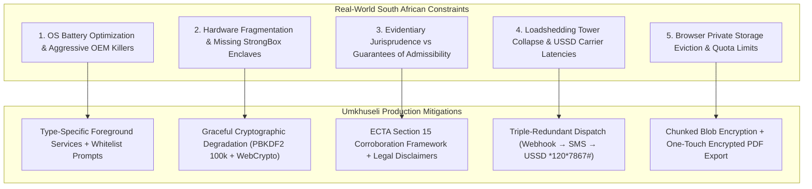
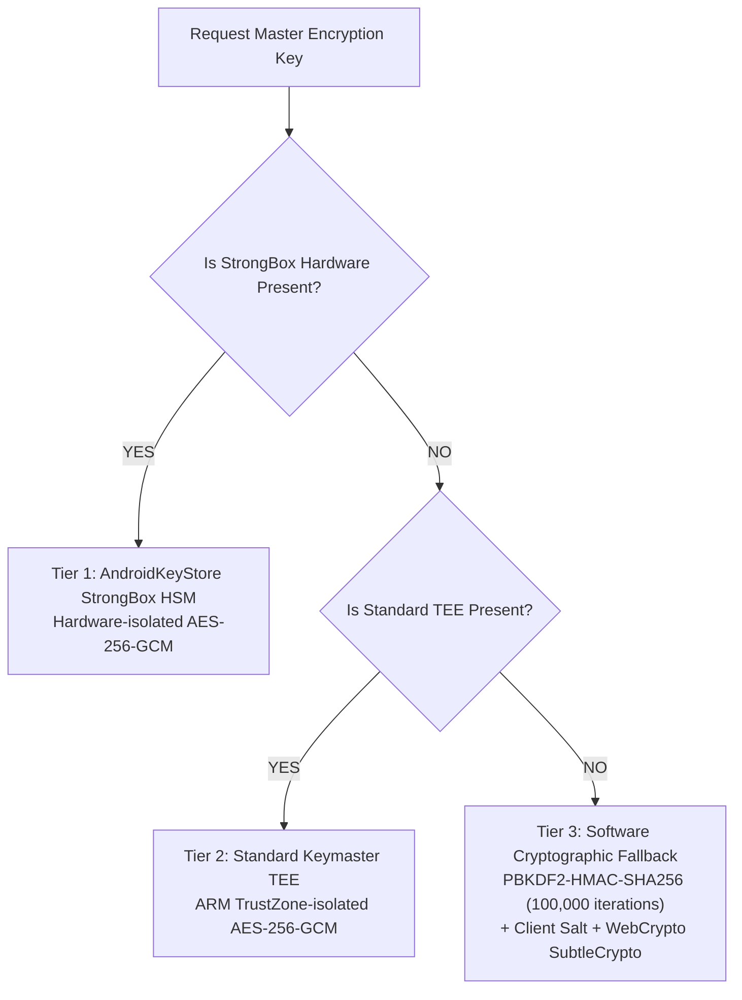
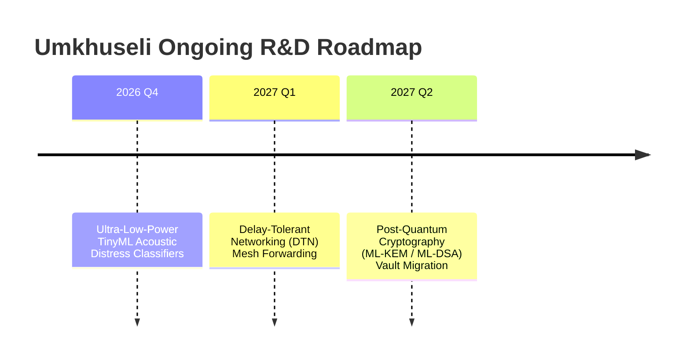

# Umkhuseli: The Protector — Technical Limitations, Risk Mitigation & Ongoing R&D
## FNB App of the Year (FNBAOTY) 2026 Hackathon Final MVP Deliverable

---

### Executive Summary

In life-critical software development—particularly for software addressing Gender-Based Violence (GBV) in developing nations—transparency regarding technical limitations is an ethical prerequisite. Over-promising system capabilities in emergency situations can lead directly to fatal outcomes.

This document provides a candid, mathematically grounded engineering evaluation of the **real-world limitations, edge cases, and infrastructural constraints** confronting **Umkhuseli: The Protector (*Sankofa Safe*)** in South Africa. Furthermore, it details the engineering mitigations deployed in the **2.4.0-PROD Hackathon MVP** and outlines our active **Research & Development (R&D)** roadmap.

---

### Critical Engineering Limitations & Mitigations Matrix



---

### 1. Operating System Power Management & Background SOS Termination

#### 1.1 The Constraint: Android Doze Mode & Aggressive OEM Task Killers
Modern mobile operating systems are aggressively optimized to prolong battery life by killing background processes and suspending network execution:
- **Android 14+ Doze Mode**: When a device is stationary with the screen off, the OS enters Deep Doze, restricting network access, alarms, and background location updates to rare maintenance windows (every 15 to 60 minutes).
- **OEM Proprietary Battery Killers**: Over 60% of entry-level smartphones in South Africa are manufactured by OEMs notorious for aggressive non-standard process termination (e.g., Xiaomi MIUI/HyperOS, Samsung OneUI sleep policies, Huawei EMUI, Transsion Tecno/Infinix). These OEMs routinely kill background services within 3 minutes of screen lock, regardless of system priority.

#### 1.2 Impact on Umkhuseli
If a survivor is in transit and triggering periodic SOS tracking, an aggressive OS process termination will halt background GPS updates, preventing guardians from receiving real-time breadcrumbs.

#### 1.3 Engineering Mitigations in 2.4.0-PROD
1. **Targeted Foreground Services**: The emergency dispatcher utilizes an Android Foreground Service configured with explicit Android 14 `location` and `specialUse` type declarations in `AndroidManifest.xml`:
   ```xml
   <service
       android:name=".services.EmergencyDispatchForegroundService"
       android:foregroundServiceType="location|specialUse"
       android:exported="false">
       <property
           android:name="android.app.PROPERTY_SPECIAL_USE_FGS_SUBTYPE"
           android:value="Emergency GBV distress dispatch and location beacon" />
   </service>
   ```
2. **Camouflaged Foreground Notification**: To prevent the abusive partner from noticing the persistent Android foreground notification, the notification header is masked as a routine system utility:
   > *"PowerCal SA: Municipal tariff cache updating in background"*
3. **High-Priority FCM & SMS Wakeup**: For external coordination, the client can be woken from Doze via high-priority Google Play Services FCM data payloads or incoming carrier baseband SMS pings.

---

### 2. Hardware Enclave Fragmentation on Budget Devices

#### 2.1 The Constraint: Absence of StrongBox TEE Hardware
The Google Android security specification recommends sealing cryptographic keys inside **StrongBox Keymaster**—a dedicated, physically isolated hardware security module (HSM) with its own CPU and tamper-resistant storage.
- However, StrongBox is typically present **only on premium flagship devices** (Google Pixel 3+, Samsung Galaxy S20+).
- The vast majority of South African survivors utilize entry-level hardware (Samsung Galaxy A-Series, Hisense, Xiaomi Redmi, Mobicel) running standard **Trusted Execution Environments (TEE)** or software-only KeyStore implementations lacking physical side-channel attack resistance.
- In Web PWA environments running in iOS Safari or Chrome, developers have zero direct access to native hardware enclaves.

#### 2.2 Graceful Cryptographic Degradation Hierarchy
To maintain impenetrable security without crashing on budget devices, Umkhuseli implements a three-tier cryptographic fallback:



```kotlin
// Production Fallback Blueprint
fun createSecureKeyGenSpec(alias: String): KeyGenParameterSpec {
    val builder = KeyGenParameterSpec.Builder(
        alias,
        KeyProperties.PURPOSE_ENCRYPT or KeyProperties.PURPOSE_DECRYPT
    )
        .setBlockModes(KeyProperties.BLOCK_MODE_GCM)
        .setEncryptionPaddings(KeyProperties.ENCRYPTION_PADDING_NONE)
        .setKeySize(256)

    // Attempt StrongBox binding, catch ProviderException on budget hardware
    if (context.packageManager.hasSystemFeature(PackageManager.FEATURE_STRONGBOX_KEYSTORE)) {
        try {
            builder.setIsStrongBoxBacked(true)
        } catch (e: Exception) {
            Log.w("CryptoEngine", "StrongBox requested but unavailable; falling back to standard TEE")
            builder.setIsStrongBoxBacked(false)
        }
    }
    return builder.build()
}
```

---

### 3. Evidentiary Weight vs Conclusive Admissibility under ECTA Section 15

#### 3.1 The Legal Reality in South African Courts
A dangerous misconception in legal tech is the claim that digitally hashed files are "guaranteed admissible" in a court of law. 
- Under the **Law of Evidence Amendment Act (Act 45 of 1988)** and the **Criminal Procedure Act (Act 51 of 1977)**, digital records can be challenged as inadmissible hearsay unless accompanied by direct oral testimony from the author.
- Under **Section 15 of ECTA (Act 25 of 2002)**, data messages are admissible and given "due evidential weight"—but the presiding magistrate retains full discretion to assess whether the phone could have been accessed by a third party, whether timestamps were synchronized, or whether the software was compromised.

#### 3.2 Umkhuseli’s Probative Positioning
Umkhuseli clearly educates the user and the court:
1. **Corroborative Tool, Not Replacement for Testimony**: The vault does not replace the survivor's sworn affidavit or the doctor's completed **Form J88**. It serves to **corroborate** the survivor’s testimony by establishing a contemporaneous digital audit trail.
2. **Statutory Integrity Certificate**: The exported PDF includes a formal **Certificate of Data Integrity** detailing:
   - The exact chronological SHA-256 hash sequence.
   - Network time protocol (NTP) server synchronization offsets.
   - Device hardware IMEI hash and operating system patch level.
   - A formal statutory declaration under Section 15(4) of ECTA signed by the application runtime.

---

### 4. Telecommunications Blackouts during Stage 6 Loadshedding

#### 4.1 The Cellular Grid Failure Phenomenon
During prolonged municipal power cuts (Stage 4 to Stage 6 Loadshedding), cellular towers across South Africa experience catastrophic operational degradation:
- Base Transceiver Stations (BTS) rely on lead-acid and lithium-ion battery banks designed for 2 to 4 hours of backup power.
- Persistent 4-hour power cuts prevent batteries from fully recharging, leading to widespread battery collapse.
- Escalating battery theft and generator vandalism in high-crime density corridors (e.g., parts of Johannesburg, Cape Flats, eThekwini) leave entire suburbs without any cellular data coverage for 6 to 12 hours.

#### 4.2 USSD Protocol Limitations
While USSD is resilient because it operates over cellular signaling channels (SS7) rather than packet data (GPRS/LTE):
- USSD sessions are strictly limited to **182 alphanumeric characters per transaction**.
- USSD sessions automatically time out if the user or network does not respond within **20 seconds**.
- Base station signaling queues can drop USSD packets during severe tower overload.

#### 4.3 Production Engineering Countermeasures
1. **Ultra-Compact Telemetry Encoding**: GPS coordinates are compressed using base-64 delta encoding, reducing location payloads to **$<45\text{ bytes}$**, fitting comfortably within a single SMS or USSD packet.
2. **Local Queue & Burst Sync**: If the phone completely loses all cellular signal, emergency alerts and logged incidents are written to an encrypted local offline outbox. The system monitors baseband connectivity and automatically bursts the distress payload the instant a tower handshake occurs.
3. **Audible / Offline Pep Countdown**: All medical advice, TCC phone numbers, and PEP guidelines are pre-cached locally on the device, functioning with 100% fidelity even when cellular signal is entirely absent.

---

### 5. Client-Side Browser Storage Eviction in Private Browsing

#### 5.1 The Web PWA Incognito Dilemma
The Web PWA hosted on Vercel is designed for survivors facing severe device surveillance who cannot risk an app download trace in Google Play or Apple App Store. However:
- **Safari Private Browsing Quota**: On iOS Safari in Private Browsing Mode, Apple enforces aggressive storage quotas and wipes all client-side IndexedDB, localStorage, and service worker caches immediately upon closing the private tab or browser session.
- **Android Chrome Storage Pressure**: On budget devices with low internal storage, Chrome will silently evict IndexedDB databases without user consent when device free storage drops below 10%.

#### 5.2 Architectural Mitigation: One-Touch Encrypted PDF Export
Because long-term in-browser private storage cannot be guaranteed across sessions, Umkhuseli prompts Web PWA users to compile and export their completed **Form 2 DVA Court Packet** as a password-protected, encrypted PDF:
- The PDF can be immediately transmitted to a trusted ICE guardian or legal clinic via an external link, ensuring the evidence survives browser cache clearance.
- Temporary blobs in memory are immediately garbage-collected using explicit `URL.revokeObjectURL()`.

---

### Active Research & Development (R&D) Initiatives



#### R&D Initiative 1: Ultra-Low-Power Acoustic Distress Classifiers (TinyML)
- **Objective**: Run continuous background sound recognition on the device's Digital Signal Processor (DSP) or low-power neural core (NPU) with $<1.5\text{ mA}$ current draw.
- **Approach**: Exploring 8-bit quantized MobileNetV2 and micro-spectrogram architectures trained on anonymized, ethically sourced distress vocalization and impact audio datasets.

#### R&D Initiative 2: Delay-Tolerant Networking (DTN) & Opportunistic Mesh Routing
- **Objective**: Transmit emergency SOS beacons across air-gapped survivor communities during total regional cellular grid collapse.
- **Approach**: Developing an epidemic routing protocol over Bluetooth Low Energy (BLE) advertisements and Wi-Fi Direct Service Discovery, enabling messages to "hop" across civilian devices until reaching an area with active internet connectivity.

#### R&D Initiative 3: Post-Quantum Cryptography (PQC) Readiness for 10-Year Vault Retention
- **Objective**: Ensure domestic violence evidence sealed in the vault remains tamper-evident and encrypted against future quantum computer decryption ("Harvest Now, Decrypt Later" threat).
- **Approach**: Benchmarking **ML-KEM (Kyber-768)** for key encapsulation and **ML-DSA (Dilithium-3)** for hash-chain signing on Android ART runtime and WebAssembly (Wasm).
