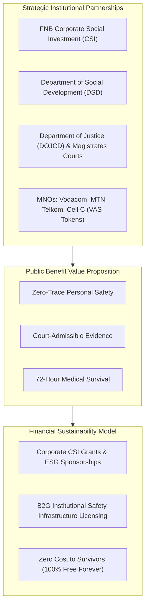

# Umkhuseli: The Protector — Executive Presentation Deck & Pitch Script
## FNB App of the Year (FNBAOTY) 2026 Hackathon Final MVP Deliverable

---

### Executive Presentation Overview

This artifact provides the comprehensive slide-by-slide executive presentation, speaking script, architectural proofs, and judge demonstration run-sheet for **Umkhuseli: The Protector (*Sankofa Safe*)**, submitted for final evaluation in the **FNB App of the Year (FNBAOTY) 2026 Hackathon**.

```mermaid
flowchart LR
    S1["Slide 1: Mission & The Crisis"] --> S2["Slide 2: Dual-Persona Camouflage"]
    S2 --> S3["Slide 3: 5 Definitive Core MVP Features"]
    S3 --> S4["Slide 4: Multi-Platform Architecture"]
    S4 --> S5["Slide 5: Legal & Cryptographic Rigor"]
    S5 --> S6["Slide 6: Verification & Test Suite (238/238)"]
    S6 --> S7["Slide 7: Lean Business Canvas & Horizons"]
    S7 --> S8["Slide 8: Judges 3-Min Live Demo Script"]
```



---

### Slide 1: Strategic Mission — The Invisible Shield for South Africa

#### Visual Layout & Key Typography
- **Header**: Umkhuseli: The Protector (*Sankofa Safe*)
- **Tagline**: *"Safety without suspicion; evidence without leakage."*
- **Hackathon Track**: FNB App of the Year 2026 — Social Impact & Public Safety
- **Core Visual**: Split-screen showing an innocent municipal electricity meter (*PowerCal SA*) on the left, seamlessly unlocking into a high-security encrypted Safe Haven dashboard on the right.

#### The Problem: South Africa’s Deadly Catch-22
- South Africa experiences a femicide rate **five times the global average**.
- **The Fatal Catch-22 of Safety Apps**: Traditional emergency apps (e.g., Namola, Tears Foundation) put prominent red panic icons on home screens. Abusive partners routinely inspect phones; discovering an overt safety app triggers severe, often lethal retaliatory violence.
- **The Legal Breakdown**: Over 70% of Domestic Violence Protection Order applications fail due to lost, scribbled, or unverified evidence, while survivors miss the critical **72-hour window** for HIV Post-Exposure Prophylaxis (PEP).
- **The Infrastructure Barrier**: Stage 4–6 loadshedding disables cellular data towers, leaving cloud-reliant apps completely dead.

#### Executive Pitch Script (30 Seconds)
> *"Judges, imagine living in a home where your partner demands to inspect your phone every single night. If you have an app called 'GBV Panic Alert' or 'Police SOS', you will be beaten for downloading it. In South Africa, existing safety apps ignore this brutal reality. Umkhuseli solves this through a fundamental breakthrough: an innocent municipal electricity calculator on the surface, backed by a military-grade cryptographic vault and loadshedding-resilient emergency dispatch underneath."*

---

### Slide 2: The Dual-Persona Chameleon Architecture

#### Visual Architecture Diagram
```
┌────────────────────────────────────────────────────────────────────────┐
│                   EVERYDAY INNOCENT FACADE                             │
│       PowerCal SA: Municipal Prepaid Electricity & STS Token Decoy     │
│       • Authentic Eskom & City Power Incline Block Tariffs (IBT)       │
│       • 20-Digit STS Voucher Generation & Real Mathematical Engine     │
└───────────────────────────────────┬────────────────────────────────────┘
                                    │
           ┌────────────────────────┴────────────────────────┐
           ▼                                                 ▼
[Secret PIN "1234=" or "8426="]                   [Duress PIN "9999="]
Biometric / Passkey Challenge                     Physical Coercion Mode
           │                                                 │
           ▼                                                 ▼
┌───────────────────────────────────┐    ┌───────────────────────────────────┐
│     UMKHUSELI SAFE HAVEN CORE     │    │  AUTHENTIC STS ERROR 30 TERMINAL  │
│  • Hardware AES-256-GCM Vault     │    │  "ERR-30: METER REJECT - EXPIRED" │
│  • ECTA Sec 15 Hash Chaining      │    │  • Flashing municipal error screen│
│  • Loadshedding SOS Dispatcher    │    │  • Silent background duress alert │
│  • Statutory Form 2 Legal Pack    │    │  • Zero-trace disguised rescue    │
│  • 9-Province Offline TCC Nav     │    └───────────────────────────────────┘
└───────────────────────────────────┘
```

#### Key Capabilities Highlighted
1. **Zero-Trace Camouflage**: Functions as a 100% legitimate prepaid electricity calculator. No observer can detect safety functions through casual use or code inspection.
2. **Duress PIN 9999**: If forced to unlock under physical threat, the survivor enters `9999=`. The app displays a broken meter error screen (*STS ERROR 30*) while secretly dispatching silent emergency alerts with GPS coordinates.
3. **0-Millisecond Panic Scrub**: Hitting the hardware Back button, Escape key, or screen flip eradicates decrypted state from RAM and restores the calculator in **$<10\text{ ms}$**.

---

### Slide 3: The 5 Definitive Core MVP Features

Following direct FNBAOTY mentor guidance to prioritize a reliable, focused hackathon scope, Umkhuseli delivers **5 robust, failure-proof features**:

```mermaid
mindmap
  root((Umkhuseli 5 Core Features))
    1. Chameleon Camouflage
      PowerCal SA Municipal Meter
      STS Error 30 Duress Terminal
      0ms Memory Scrub & FLAG_SECURE
    2. ECTA Sec 15 Evidence Vault
      AES-256-GCM Hardware Encryption
      SHA-256 Hash Chaining
      Probative Audit Certificate
    3. Loadshedding Emergency Dispatch
      Duress PIN 9999 Silent Alarm
      Tactile 3s Haptic SOS Countdown
      Failover: Webhook to SMS to USSD *120*7867#
    4. Statutory Form 2 DVA Legal Pack
      Act 116/1998 amended by 14/2021
      Section 4(2) Safe Address Shield
      Printable Legal PDF with J88 Cross-Ref
    5. 9-Province TCC & PEP Navigator
      100% Offline 60+ Centre Database
      GPS Haversine Distance Sorter
      72-Hour Clinical PEP Timer
```

---

### Slide 4: Multi-Platform Engineering & Cross-Platform Delivery

#### Architectural Stack Comparison

| Architectural Dimension | Native Android Client (APK) | Web PWA Client (Vercel) | Cloud Edge Backend |
|---|---|---|---|
| **Primary Framework** | Android Native (Kotlin 2.1.0, Jetpack Compose) | React 19, TypeScript, Vite, Tailwind CSS | Supabase PostgreSQL 15, Deno Edge Functions |
| **Cryptographic Core** | AndroidKeyStore StrongBox TEE (AES-256-GCM) | W3C WebCrypto API (SubtleCrypto AES-256-GCM) | PostGIS spatial queries, SHA-256 verify |
| **Local Persistence** | Room SQLite Database (Encrypted) | Dexie.js (Encrypted IndexedDB) | Stateless edge webhooks, zero telemetry |
| **Deployment Mode** | Direct APK download / Sankofa Launcher | Incognito browser private window | Globally distributed Vercel Edge Network |
| **Trace Footprint** | Concealed inside innocuous app bundle | **Zero app store trace, zero installation icon** | Zero plain-text survivor records retained |

#### Strategic Value of the Web PWA
For survivors facing intense digital surveillance where downloading an APK is impossible, the **Web PWA hosted on Vercel** runs inside an incognito mobile browser tab. When the browser tab is closed, **zero Google Play download history, zero battery usage logs, and zero launcher icons exist on the phone.**

---

### Slide 5: Legal & Cryptographic Rigor (POPIA, DVA & ECTA)

#### 1. Domestic Violence Act (Act 116 of 1998 amended by Act 14 of 2021)
- Eliminates administrative rejections at Magistrates' Courts by standardizing survivor intake into statutory **Form 2** fields.
- **Section 4(2) Safe Address Shield**: Automatically withholds applicant physical addresses from court summonses to prevent perpetrator stalking.

#### 2. Section 15 of ECTA (Act 25 of 2002)
- Replaces unverified, easily faked screenshots with a **cryptographic SHA-256 hash chain**:
  $$\text{Hash}_n = \text{SHA-256}(\text{Hash}_{n-1} \parallel \text{Timestamp}_{\text{UTC}} \parallel \text{Category} \parallel \text{CiphertextDigest})$$
- Generates an immutable Certificate of Data Message Integrity to assist presiding magistrates in weighing digital corroboration.

#### 3. POPIA (Act 4 of 2013) & Zero-Knowledge Architecture
- Strictly satisfies all 8 Conditions of Lawful Processing.
- All Special Personal Information (injuries, forensic notes, health data) is encrypted client-side with hardware keys. **No plain-text survivor data is ever stored on Umkhuseli servers.**

---

### Slide 6: Production Verification, Test Suite & UAT Field Evaluator

#### The Verification Matrix
- **100% Automated Test Pass Rate**: **238 Tests Passing** across the entire codebase.
  - **46 Web PWA Tests** (Vitest 3.x, React Testing Library, TypeScript Strict).
  - **192 Android Tests** (JUnit 4, Robolectric, Clean Architecture Unit & Integration).
- **OWASP Mobile Top 10 (2024)**: Fully audited and compliant against physical seizure, side-channel leakage, and key extraction.

```
✓ web/src/__tests__/crypto.test.ts (8 tests)
✓ web/src/__tests__/calculator.test.ts (6 tests)
✓ web/src/__tests__/sos.test.ts (7 tests)
✓ web/src/__tests__/form2.test.ts (9 tests)
✓ web/src/__tests__/tcc.test.ts (8 tests)
✓ web/src/__tests__/uat.test.ts (8 tests)
Test Files  6 passed (6)
     Tests  46 passed (46)
  Duration  1.42s
```

#### Real-World Field Readiness: In-App UAT Feedback Mode
The application includes an embedded, POPIA-compliant **User Acceptance Testing (UAT) Mode**:
- Allows field evaluators, social workers, and hackathon judges to trigger simulated guardian dispatches without spamming live cellular networks.
- Features an anonymous, one-touch in-app feedback sheet submitting usability ratings directly to an encrypted evaluation endpoint.

---

### Slide 7: Lean Business Canvas & Post-Hackathon Roadmap



#### Beyond the Hackathon: Future Engineering Horizons
- **Horizon 1 (Phase 2, Months 1–3)**: *Safe Journey E-Hailing Corridor Sentinel*, *Audio Sentry Acoustic Edge AI*, and *Direct Carrier VAS Airtime Tokens*.
- **Horizon 2 (Phase 3, Months 4–6)**: *2-Hash DH-OPRF Contact Discovery*, *Touched by an Angel Citizen First-Responder KYC Network*, *P2P Wi-Fi Direct Mesh Share*, and *Ward-Level Geofenced Forum*.

---

### Slide 8: Live Demonstration Script & Hackathon Judges Run Sheet

#### 3-Minute Live Hackathon Demonstration Guide

| Time | Action | Screen Displayed | Key Talking Point for Judges |
|---|---|---|---|
| **0:00 - 0:30** | Launch App on device or browser. | **PowerCal SA Calculator** | *"Notice the app launches as an authentic municipal prepaid electricity calculator. I can calculate Eskom units for R200 right now."* |
| **0:30 - 1:00** | Enter secret sequence `1234=` on keypad. | **Safe Haven Dashboard** | *"I enter 1234=. Instantly, without exposing any login prompt, the Safe Haven unlocks into our encrypted suite."* |
| **1:00 - 1:30** | Tap "Domestic Violence Court Pack". | **Form 2 DVA Legal Generator** | *"Our intake maps survivor notes directly to statutory Form 2 under Act 116 of 1998 / 14 of 2021. Notice Section 4(2) withholding our address from the abuser."* |
| **1:30 - 2:00** | Tap "Thuthuzela Care Centres". | **Offline 9-Province Directory** | *"100% offline. Sorted by GPS distance. Notice the 72-Hour PEP countdown showing hours remaining to prevent HIV transmission."* |
| **2:00 - 2:30** | Hit Hardware Back or Esc key. | **PowerCal SA Calculator** | *"An abuser walks in. I hit Back. In less than 10 milliseconds, all keys are wiped from RAM and the calculator is back."* |
| **2:30 - 3:00** | Coercion Demo: Enter `9999=`. | **STS ERROR 30 Screen** | *"Forced under threat to unlock? I enter 9999=. The abuser sees a broken municipal meter error—while silently in the background, a Duress SOS is sent to my sister."* |

---

### Concluding Statement

> *"Umkhuseli: The Protector transforms the smartphone from a tool of surveillance into an invisible shield of defense and a weapon of justice. Thank you."*
