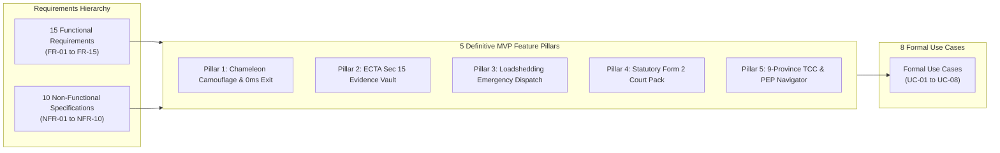
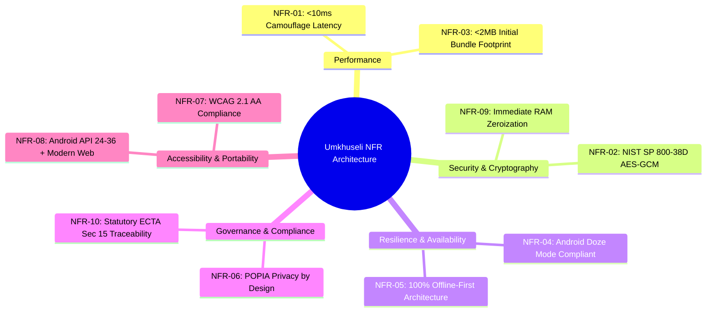

# Umkhuseli: The Protector — Requirements Specification & Formal Use Cases
## FNB App of the Year (FNBAOTY) 2026 Hackathon Final MVP Deliverable

---

### Executive Summary

This document specifies the complete, authoritative functional and non-functional requirements and formal use cases for **Umkhuseli: The Protector (*Sankofa Safe*)**, delivered for the **FNB App of the Year (FNBAOTY) 2026 Hackathon Final MVP**.

Designed specifically to confront Gender-Based Violence (GBV) and Intimate Partner Violence (IPV) in South Africa, Umkhuseli’s requirement architecture is prioritized around **survivor safety under physical coercion**, **resilience during municipal grid collapse (Stage 1–6 loadshedding)**, and **statutory compliance with the South African Domestic Violence Act (Act 116 of 1998 as amended by Act 14 of 2021)** and **Section 15 of the Electronic Communications and Transactions Act (ECTA 25 of 2002)**.

---

### Requirements Traceability Matrix Overview

---

### Functional Requirements Matrix (FR-01 to FR-15)

| Requirement ID | Module / Feature Pillar | Requirement Name | Description & Acceptance Standard | Priority |
|---|---|---|---|---|
| **FR-01** | Camouflage Decoy | **Municipal Prepaid Meter Engine** | The app must launch by default into an authentic prepaid electricity calculator (*PowerCal SA*) featuring Eskom, City Power, and Ekurhuleni Incline Block Tariffs (IBT) and 20-digit STS token formatting. | **P0 (Mandatory)** |
| **FR-02** | Camouflage Decoy | **Covert PIN & Gesture Entry** | Safe Haven must be accessible via secret arithmetic sequence (e.g., `1234=`, `8426=`) or subtle emblem gesture, without exposing conventional login screens. | **P0 (Mandatory)** |
| **FR-03** | Camouflage Decoy | **Duress PIN 9999 Terminal Error** | Entering `9999=` must immediately render an authentic municipal error screen (*STS ERROR 30: TOKEN EXPIRED / KEY FAILURE*) while silently dispatching an urgent SOS beacon in the background. | **P0 (Mandatory)** |
| **FR-04** | Camouflage Decoy | **0-ms Panic Scrub** | Tapping the hardware Back key, Escape, or dual-finger screen swipe must wipe decrypted state from memory and revert UI to the calculator in $<10\text{ ms}$. | **P0 (Mandatory)** |
| **FR-05** | Evidence Vault | **AES-256-GCM Encryption** | All incident notes, voice notes, and media attachments must be encrypted on-device using AES-256-GCM backed by AndroidKeyStore StrongBox TEE or WebCrypto API. | **P0 (Mandatory)** |
| **FR-06** | Evidence Vault | **ECTA Section 15 Hash Chaining** | Each committed incident record must calculate a SHA-256 cryptographic digest chained to the previous record hash: $H_n = \text{SHA256}(H_{n-1} \parallel \text{Timestamp} \parallel \text{Data})$, guaranteeing chronological integrity. | **P0 (Mandatory)** |
| **FR-07** | Emergency Dispatch | **Tactile 3-Second SOS Countdown** | Triggering SOS must initiate a 3000ms pulsating haptic countdown with an abort button to prevent accidental dispatches. | **P0 (Mandatory)** |
| **FR-08** | Emergency Dispatch | **Multi-Portal Alert Dispatch** | When countdown elapses, the system must dispatch distress payloads containing GPS coordinates and battery level across Webhook, SMS, and WhatsApp channels. | **P0 (Mandatory)** |
| **FR-09** | Emergency Dispatch | **Loadshedding & Offline Fallback** | In the event of cellular tower blackouts or no internet data, the system must automatically fall back to GSM SMS transmission and prompt zero-airtime USSD `*120*7867#`. | **P0 (Mandatory)** |
| **FR-10** | Legal Court Pack | **Statutory Form 2 Guided Intake** | The app must provide an empathetic, structured questionnaire mapping directly to statutory sections of Form 2 under Domestic Violence Act 116 of 1998 / 14 of 2021. | **P0 (Mandatory)** |
| **FR-11** | Legal Court Pack | **Section 4(2) Safe Address Shield** | The system must provide a mandatory opt-in to legally omit the survivor’s physical address from court summons served on the abusive respondent. | **P0 (Mandatory)** |
| **FR-12** | Legal Court Pack | **Court-Ready PDF & J88 Linkage** | The app must compile a complete, printable Form 2 court application PDF including chronological incident logs, SHA-256 audit certificates, and SAPS CAS / Hospital J88 cross-references. | **P0 (Mandatory)** |
| **FR-13** | Healthcare Navigator | **Offline 9-Province TCC Directory** | The app must maintain an embedded, zero-data database of all accredited Thuthuzela Care Centres across South Africa, sorted dynamically by device GPS distance. | **P0 (Mandatory)** |
| **FR-14** | Healthcare Navigator | **72-Hour PEP Clinical Countdown** | The system must display a real-time clinical countdown highlighting the critical 72-hour window for HIV Post-Exposure Prophylaxis and forensic examination. | **P0 (Mandatory)** |
| **FR-15** | Cross-Platform | **Zero-Trace Incognito PWA** | The platform must provide a fully functional Progressive Web App deployed on Vercel, runnable in private browser mode leaving zero download or icon footprint on the device. | **P0 (Mandatory)** |

---

### Non-Functional Requirements Matrix (NFR-01 to NFR-10)

| NFR ID | Quality Attribute | Technical Specification & Benchmark |
|---|---|---|
| **NFR-01** | **Panic Exit Latency** | Memory scrub and UI camouflage transition must complete within **$<10\text{ ms}$** of trigger event on both budget and flagship hardware. |
| **NFR-02** | **Cryptographic Rigor** | Encryption must adhere strictly to **NIST SP 800-38D** standards (AES-256 in Galois/Counter Mode with 96-bit unique IVs and 128-bit authentication tags). |
| **NFR-03** | **Network & Data Footprint** | PWA initial bundle must not exceed **2.0 MB** uncompressed; core utility functions must operate with **0 bytes of data transfer**. |
| **NFR-04** | **Power & Battery Efficiency** | Background SOS monitoring must utilize Android Foreground Services with `location` and `specialUse` types, surviving system **Doze Mode** with $<0.5\%$ hourly battery drain. |
| **NFR-05** | **Loadshedding Resilience** | 100% of Vault, Camouflage, Form 2, and TCC Directory features must operate completely **offline without network connectivity**. |
| **NFR-06** | **POPIA Privacy & Minimization** | Zero third-party telemetry, tracking pixels, or analytic SDKs; zero plain-text personal data persisted on server infrastructure. |
| **NFR-07** | **Accessibility (a11y)** | UI must conform to **WCAG 2.1 Level AA**, maintaining a minimum 4.5:1 contrast ratio and full TalkBack/Screen Reader compatibility. |
| **NFR-08** | **Device Portability** | Android client must support **Android 7.0 (Nougat / API 24) through Android 15 (Vanilla Ice Cream / API 36)**. Web client must support Safari, Chrome, and Firefox mobile browsers. |
| **NFR-09** | **Tamper Resilience** | Memory-sensitive arrays (cryptographic keys, decrypted notes) must be stored in mutable structures and explicitly overwritten with zero bytes upon exit. |
| **NFR-10** | **Evidentiary Traceability** | Hash chains and audit certificates must provide verifiable mathematical proof of document immutability under Section 15 of ECTA (Act 25 of 2002). |

---

### Formal Use Cases (UC-01 to UC-08)

#### Use Case 01: Everyday Prepaid Electricity Meter Calculation
- **Primary Actor**: Survivor or Casual Observer / Partner.
- **Goal**: Calculate electricity units and view municipal tariffs using the innocent decoy.
- **Preconditions**: Application is launched normally from device home screen or browser bookmark.
- **Main Success Scenario**:
  1. User launches application.
  2. System displays *PowerCal SA* municipal prepaid meter screen.
  3. User selects municipality (e.g., "City Power - Johannesburg") and inputs currency amount (e.g., `R250`).
  4. System executes Incline Block Tariff formula and displays calculated units (`88.6 kWh`), VAT rate (15%), and simulated STS receipt.
- **Postconditions**: No safety features, vault icons, or emergency capabilities are visible.

---

#### Use Case 02: Covert PIN Safe Haven Entry & Biometric Verification
- **Primary Actor**: Survivor.
- **Goal**: Access confidential Safe Haven features without attracting attention.
- **Preconditions**: Application is displaying the *PowerCal SA* calculator.
- **Main Success Scenario**:
  1. Survivor enters secret arithmetic PIN sequence `1234=` on the calculator keypad.
  2. System detects valid authorized unlock sequence.
  3. System prompts for biometric verification (Fingerprint / Face ID) or fallback passphrase.
  4. Survivor authenticates successfully.
  5. System derives cryptographic session key and renders the Safe Haven dashboard.
- **Alternate Scenario (Invalid PIN)**:
  - 1a. User enters non-matching sequence (e.g., `5678=`).
  - 2a. System treats input as standard mathematical operation, displays calculation result, and remains in decoy mode.
- **Postconditions**: Vault unlocked in memory; `FLAG_SECURE` enabled on Android window.

---

#### Use Case 03: Forced Coercive Inspection & Duress PIN 9999 Dispatch
- **Primary Actor**: Survivor (under physical threat from Abuser).
- **Goal**: Provide convincing fake error to abuser while secretly requesting emergency intervention.
- **Preconditions**: Abuser demands survivor unlock the application on their phone.
- **Main Success Scenario**:
  1. Survivor opens *PowerCal SA* in front of abuser.
  2. Survivor inputs Duress PIN `9999=`.
  3. System immediately transitions UI to flashing municipal terminal error: *"STS ERROR 30: METER REJECT - KEY REVISION OUTDATED. Contact Eskom 08600 37566"*.
  4. In the background without audio or visual indicator, system acquires GPS coordinates.
  5. System dispatches silent Duress SOS beacon to pre-configured ICE contacts via Webhook and direct SMS.
  6. Abuser inspects screen, concludes meter software is malfunctioning, and returns device.
- **Postconditions**: Silent alarm dispatched; ICE guardian alerted; abuser suspects nothing.

---

#### Use Case 04: Emergency Tactile SOS Trigger with 3-Second Abort Countdown
- **Primary Actor**: Survivor in imminent danger.
- **Goal**: Dispatch emergency distress signals with location to trusted contacts.
- **Preconditions**: Survivor has accessed Emergency SOS screen or triggered tactile hardware sequence.
- **Main Success Scenario**:
  1. Survivor presses and holds large tactile "HOLD FOR SOS" button.
  2. Device triggers rhythmic haptic pulsing and begins 3-second countdown (3... 2... 1...).
  3. Survivor holds button until countdown reaches 0.
  4. System acquires highest-accuracy GPS coordinates.
  5. System dispatches multi-channel alerts (Cloud Webhook + Direct SMS + WhatsApp).
  6. Screen displays confirmation: *"Emergency Beacon Dispatched to 2 Contacts"*.
- **Alternate Scenario (User Cancels within 3 Seconds)**:
  - 2a. User releases button or taps "Cancel Alert" before timer hits 0.
  - 3a. System halts countdown immediately, cancels transmissions, and returns to idle state.
- **Postconditions**: Emergency alerts successfully transmitted or safely aborted.

---

#### Use Case 05: 0-Millisecond Panic Scrub on Hostile Approach
- **Primary Actor**: Survivor browsing sensitive records.
- **Goal**: Instantly hide evidence and scrub memory when an abuser enters the room.
- **Preconditions**: Survivor is viewing Safe Haven Evidence Vault or Form 2 documents.
- **Main Success Scenario**:
  1. Abuser suddenly enters the room.
  2. Survivor presses hardware Back button, Escape key, or executes two-finger swipe.
  3. System catches event before standard window lifecycle handlers.
  4. System immediately sets view back to *PowerCal SA* calculator.
  5. System overwrites in-memory cryptographic key arrays with zero bytes and purges activity backstack.
  6. UI renders municipal calculator within $<10\text{ ms}$.
- **Postconditions**: All sensitive data eradicated from RAM; no trace remains in recent apps.

---

#### Use Case 06: Secure Incident Logging with ECTA Section 15 Hash Chaining
- **Primary Actor**: Survivor.
- **Goal**: Create an encrypted, tamper-evident log of a domestic violence event.
- **Preconditions**: Safe Haven is unlocked.
- **Main Success Scenario**:
  1. Survivor taps "New Incident Record".
  2. Survivor selects abuse category (Physical, Emotional, Economic, etc.) and enters narrative description.
  3. Survivor attaches photographs of injuries/damage and enters SAPS CAS number if reported.
  4. Survivor taps "Save to Vault".
  5. System encrypts payload with AES-256-GCM.
  6. System computes chained SHA-256 hash using previous incident's block digest: $H_n = \text{SHA256}(H_{n-1} \parallel \dots)$.
  7. System commits encrypted block to local database.
- **Postconditions**: Incident securely saved and immutably linked into cryptographic audit chain.

---

#### Use Case 07: Compiling & Exporting Statutory Form 2 DVA Court Preparation Pack
- **Primary Actor**: Survivor preparing to file for Protection Order.
- **Goal**: Export a completed, legally compliant Form 2 court application with evidentiary schedule.
- **Preconditions**: Survivor has logged one or more incidents in the vault.
- **Main Success Scenario**:
  1. Survivor selects "Prepare Form 2 Court Application".
  2. System guides survivor through questions matching the Domestic Violence Act Form 2 statutory layout.
  3. Survivor checks "Withhold my residential address from respondent under Section 4(2)".
  4. System validates completeness and cross-references logged incidents and J88 medical numbers.
  5. Survivor taps "Export Legal PDF".
  6. System compiles standardized, printable PDF complete with statutory Form 2 layout, ECTA Section 15 audit certificate, and chronological incident logs.
- **Postconditions**: Comprehensive legal document generated, ready for submission to Magistrates' Court.

---

#### Use Case 08: Offline Geolocation-Sorted TCC Navigation & 72-Hour PEP Activation
- **Primary Actor**: Sexual assault survivor.
- **Goal**: Locate closest specialized medical facility and access preventative care within 72 hours.
- **Preconditions**: Application launched; device location available or manually selected.
- **Main Success Scenario**:
  1. Survivor selects "Medical Assistance & Thuthuzela Centres".
  2. System queries embedded 9-province directory database without requiring internet connection.
  3. System calculates Haversine distance from current coordinates to all accredited facilities.
  4. System displays nearest facilities sorted by proximity (e.g., "Chris Hani Baragwanath TCC - 2.8 km away - Open 24/7").
  5. System presents 72-Hour PEP clinical countdown with explanation of HIV and emergency contraception urgency.
  6. Survivor taps "One-Touch Emergency Call" to dial TCC crisis coordinator directly.
- **Postconditions**: Survivor guided safely to 24/7 specialized care before clinical window expires.
