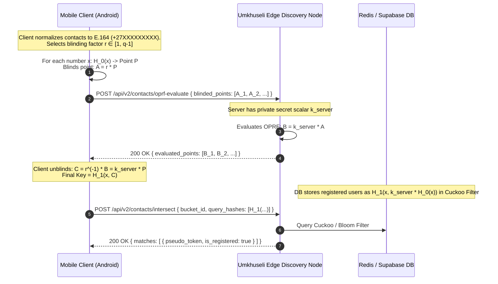
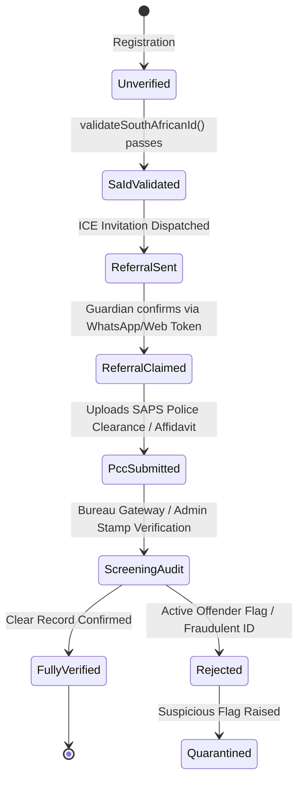
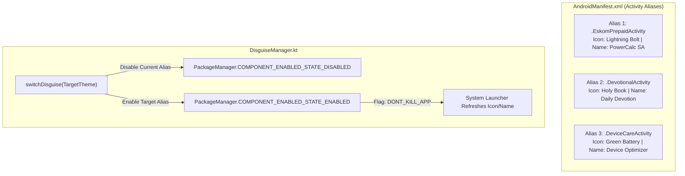
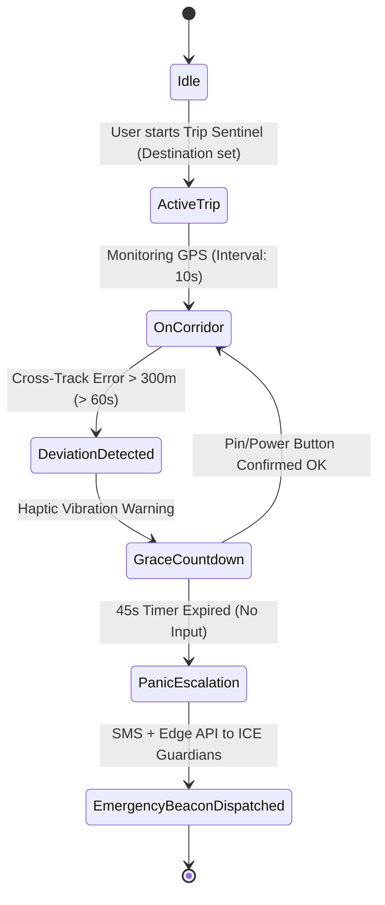
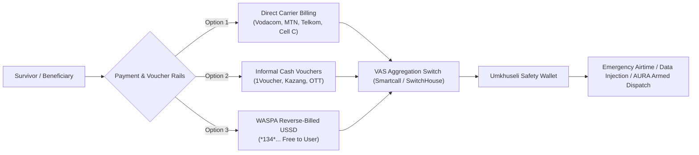

# Umkhuseli: The Protector — Comprehensive Technical Architecture & Feature Specifications

**Target Architecture Version:** 2.0.0-PROD  
**Target Environment:** Android (API 24 to 36 / Jetpack Compose), Web PWA (Svelte/Vite/TypeScript), Supabase PostgreSQL 15+ (PostGIS & Edge Functions)  
**Regulatory & Legal Framework:** South African POPIA (Act 4 of 2013), Domestic Violence Act (Act 116 of 1998 / Act 14 of 2021), Criminal Law (Sexual Offences and Related Matters) Amendment Act, Criminal Procedure Act (Act 51 of 1977), WASPA Code of Conduct 16.0.

---

## Table of Contents
1. [Feature 1: Privacy-Preserving Contact Discovery & Localized Community Forum](#feature-1-privacy-preserving-contact-discovery--community-forum)
2. [Feature 2: ICE Referral & Comprehensive Profile Verification Pipeline](#feature-2-ice-referral--comprehensive-profile-verification-pipeline)
3. [Feature 3: Geospatial Incident Heat Map](#feature-3-geospatial-incident-heat-map)
4. [Feature 4: Safe Anonymous Whistleblower & Crime Reporting](#feature-4-safe-anonymous-whistleblower--crime-reporting)
5. [Feature 5: App Identity, Persona & Disguise Overhaul](#feature-5-app-identity-persona--disguise-overhaul)
6. [Feature 6: 3 Standout Features for Prevalent South African GBV Scenarios](#feature-6-3-standout-features-for-prevalent-south-african-gbv-scenarios)
7. [Feature 7: 'Touched by an Angel' Vetted Citizen First-Responder Network](#feature-7-touched-by-an-angel-vetted-citizen-first-responder-network)
8. [Feature 8: Airtime / Mobile Data Token Purchase (VAS & Direct Carrier Billing)](#feature-8-airtime--mobile-data-token-purchase-vas--direct-carrier-billing)

---

# Feature 1: Privacy-Preserving Contact Discovery & Community Forum

## 1.1 Problem & Threat Vector in South Africa
In South Africa, standard contact discovery requires uploading a user's entire address book to backend servers in plaintext. If an abusive partner or hostile actor intercepts traffic, or if the server is compromised, survivors' social networks and emergency allies are exposed. Furthermore, naive phone number hashing (e.g., standard SHA-256) is completely vulnerable to brute-force rainbow table attacks because the South African mobile number space is bounded (only ~100 million valid MSISDNs with prefixes `+27 6x`, `+27 7x`, `+27 8x`), allowing an attacker to precompute all hashes in under 15 seconds.

## 1.2 Cryptographic Protocol: 2-Hash DH-OPRF (Elliptic Curve Oblivious PRF)
To achieve secure Private Set Intersection (PSI) without leaking the client's contact list or allowing the server to construct a rainbow table, Umkhuseli adopts a 2-Hash Elliptic Curve Diffie-Hellman Oblivious Pseudorandom Function (2Hash-DH-OPRF) over Curve25519 (or Ristretto255).



### Protocol Mathematical Steps:
1. Let $E$ be Curve25519, order $q$, generator $G$. $H_0: \{0,1\}^* \to E$ maps a normalized phone number to a curve point. $H_1: \{0,1\}^* \times E \to \{0,1\}^{256}$ is a cryptographically secure hash function (BLAKE3).
2. Client chooses random scalar $r \xleftarrow{R} \mathbb{Z}_q^*$ for each contact $x$, computes blinded point $A = r \cdot H_0(x)$.
3. Server computes $B = k_s \cdot A$ using secret server key $k_s$.
4. Client multiplies by modular inverse $r^{-1} \pmod q$: $C = r^{-1} \cdot B = r^{-1} \cdot (k_s \cdot r \cdot H_0(x)) = k_s \cdot H_0(x)$.
5. The resulting value $K_x = H_1(x, C)$ cannot be precomputed by the server (because the server never saw $x$ or $H_0(x)$ unblinded), nor by third parties.

## 1.3 Localized Community Forum Architecture
- **Safety Circles:** Defined by municipal wards or PostGIS polygons (e.g., Soweto - Ward 24, Khayelitsha - Site B, Sunnyside - Ward 81).
- **Pseudonymous Identity Rotation:** Users post under non-linkable rotating pseudonyms derived via:
  $$\text{Pseudonym} = \text{Truncate}_{12}(\text{HMAC-SHA256}(\text{UserMasterSalt}, \text{CircleID} \parallel \text{CalendarMonth}))$$
  This prevents cross-circle tracking and persistent profile profiling by domestic abusers.
- **Community Moderation:** Quadratic trust voting, threshold reporting ($N=3$ flags automatically quarantine a post pending community elder review), zero IP storage.

## 1.4 Data Schemas (PostgreSQL & TypeScript)

```sql
-- 1. Forum Safety Circles (Geofenced Communities)
CREATE TABLE IF NOT EXISTS public.forum_circles (
    id UUID PRIMARY KEY DEFAULT gen_random_uuid(),
    name TEXT NOT NULL, -- e.g., "Soweto West Safety Circle", "Hatfield Student Corridor"
    ward_code TEXT NOT NULL, -- IEC Ward Identifier (e.g., "79800024")
    municipality TEXT NOT NULL, -- City of Johannesburg, City of Cape Town
    province TEXT NOT NULL,
    boundary GEOGRAPHY(Polygon, 4326) NOT NULL,
    is_active BOOLEAN DEFAULT TRUE,
    created_at TIMESTAMPTZ DEFAULT TIMEZONE('utc', NOW()) NOT NULL
);

CREATE INDEX IF NOT EXISTS idx_forum_circles_boundary ON public.forum_circles USING GIST(boundary);

-- 2. Forum Posts (Pseudonymous & Ephemeral)
CREATE TABLE IF NOT EXISTS public.forum_posts (
    id UUID PRIMARY KEY DEFAULT gen_random_uuid(),
    circle_id UUID NOT NULL REFERENCES public.forum_circles(id) ON DELETE CASCADE,
    author_pseudonym TEXT NOT NULL, -- Ephemeral monthly hash
    post_type TEXT NOT NULL CHECK (post_type IN ('SAFETY_ALERT', 'TAXI_STATUS', 'LIGHTING_ISSUE', 'SUPPORT_REQUEST')),
    title TEXT NOT NULL,
    body TEXT NOT NULL,
    h3_index TEXT, -- H3 resolution 8 hex for localized context
    upvotes INT DEFAULT 0,
    downvotes INT DEFAULT 0,
    flag_count INT DEFAULT 0,
    is_quarantined BOOLEAN DEFAULT FALSE,
    expires_at TIMESTAMPTZ DEFAULT TIMEZONE('utc', NOW() + INTERVAL '14 days'),
    created_at TIMESTAMPTZ DEFAULT TIMEZONE('utc', NOW()) NOT NULL
);

CREATE INDEX IF NOT EXISTS idx_forum_posts_circle_created ON public.forum_posts(circle_id, created_at DESC);
CREATE INDEX IF NOT EXISTS idx_forum_posts_h3 ON public.forum_posts(h3_index);

-- 3. Contact Discovery Registered Hash Register
CREATE TABLE IF NOT EXISTS public.contact_discovery_tokens (
    token_hash CHAR(64) PRIMARY KEY, -- H_1(x, k_s * H_0(x))
    user_id UUID NOT NULL REFERENCES auth.users(id) ON DELETE CASCADE,
    bucket_prefix CHAR(4) NOT NULL, -- Sharding prefix for fast lookup
    updated_at TIMESTAMPTZ DEFAULT TIMEZONE('utc', NOW()) NOT NULL
);

CREATE INDEX IF NOT EXISTS idx_contact_discovery_bucket ON public.contact_discovery_tokens(bucket_prefix);
```

```typescript
// TypeScript Contract Models
export interface OprfEvaluateRequest {
  blindedPoints: string[]; // Base64 encoded Ristretto255 points
}

export interface OprfEvaluateResponse {
  evaluatedPoints: string[]; // Base64 encoded points multiplied by server secret
}

export interface ContactIntersectionQuery {
  bucketPrefix: string;
  queryHashes: string[]; // BLAKE3 hex hashes
}

export interface ContactMatchResult {
  matches: {
    tokenHash: string;
    pseudonymToken: string;
    isRegistered: boolean;
  }[];
}

export interface ForumCircle {
  id: string;
  name: string;
  wardCode: string;
  municipality: string;
  province: string;
}

export interface ForumPost {
  id: string;
  circleId: string;
  authorPseudonym: string;
  postType: 'SAFETY_ALERT' | 'TAXI_STATUS' | 'LIGHTING_ISSUE' | 'SUPPORT_REQUEST';
  title: string;
  body: string;
  h3Index?: string;
  upvotes: number;
  downvotes: number;
  createdAt: string;
}
```

---

# Feature 2: ICE Referral & Comprehensive Profile Verification Pipeline

## 2.1 Automated SMS/WhatsApp Referral with Single-Use Tokens
When a user adds an In-Case-of-Emergency (ICE) Guardian, the system dispatches an automated, tamper-resistant invitation via Twilio SMS / WhatsApp Business Cloud API.
- **Invite Token:** Single-use, 256-bit entropy cryptographic URL (`https://safe.umkhuseli.org/ice/claim#t=<token>`).
- **Security Guarantee:** Token payload is signed with an HMAC-SHA256 secret. The server stores only the SHA-256 digest of the token with a 72-hour time-to-live (TTL).

## 2.2 South African National ID Validation (Luhn + Demographic Extraction)
The South African National ID consists of 13 numeric digits: `YYMMDD SSSS C A Z`
- `YYMMDD`: Date of birth.
- `SSSS`: Gender indicator (0000 - 4999 = Female, 5000 - 9999 = Male).
- `C`: Citizenship (0 = SA Citizen, 1 = Permanent Resident).
- `A`: Usually 8 or 9 (historical racial classification slot, now static).
- `Z`: Luhn verification checksum digit.

```typescript
export interface SaIdValidationResult {
  isValid: boolean;
  dateOfBirth?: string; // YYYY-MM-DD
  gender?: 'FEMALE' | 'MALE';
  citizenship?: 'CITIZEN' | 'PERMANENT_RESIDENT';
  age?: number;
  errorCode?: 'INVALID_LENGTH' | 'INVALID_CHARACTERS' | 'INVALID_DATE' | 'LUHN_FAILED';
}

export function validateSouthAfricanId(idNumber: string): SaIdValidationResult {
  const sanitized = idNumber.trim().replace(/\s+/g, '');
  if (!/^\d{13}$/.test(sanitized)) {
    return { isValid: false, errorCode: sanitized.length !== 13 ? 'INVALID_LENGTH' : 'INVALID_CHARACTERS' };
  }

  // 1. Luhn Checksum Validation
  let sum = 0;
  for (let i = 0; i < 13; i++) {
    let digit = parseInt(sanitized.charAt(i), 10);
    if (i % 2 === 1) { // 2nd, 4th, 6th... (1-indexed: even positions)
      digit *= 2;
      if (digit > 9) digit -= 9;
    }
    sum += digit;
  }
  if (sum % 10 !== 0) {
    return { isValid: false, errorCode: 'LUHN_FAILED' };
  }

  // 2. Extract Date of Birth
  const yy = parseInt(sanitized.substring(0, 2), 10);
  const mm = parseInt(sanitized.substring(2, 4), 10);
  const dd = parseInt(sanitized.substring(4, 6), 10);

  const currentYear = new Date().getFullYear() % 100;
  const century = yy <= currentYear ? 2000 : 1900;
  const fullYear = century + yy;

  const dobDate = new Date(fullYear, mm - 1, dd);
  if (
    dobDate.getFullYear() !== fullYear ||
    dobDate.getMonth() !== mm - 1 ||
    dobDate.getDate() !== dd
  ) {
    return { isValid: false, errorCode: 'INVALID_DATE' };
  }

  // 3. Extract Gender & Citizenship
  const genderCode = parseInt(sanitized.substring(6, 10), 10);
  const gender = genderCode >= 5000 ? 'MALE' : 'FEMALE';
  const citizenshipCode = parseInt(sanitized.charAt(10), 10);
  const citizenship = citizenshipCode === 0 ? 'CITIZEN' : 'PERMANENT_RESIDENT';

  const today = new Date();
  let age = today.getFullYear() - dobDate.getFullYear();
  const m = today.getMonth() - dobDate.getMonth();
  if (m < 0 || (m === 0 && today.getDate() < dobDate.getDate())) {
    age--;
  }

  return {
    isValid: true,
    dateOfBirth: `${fullYear}-${String(mm).padStart(2, '0')}-${String(dd).padStart(2, '0')}`,
    gender,
    citizenship,
    age
  };
}
```

## 2.3 Offender Verification Protocol: Legal Feasibility & Architecture
### Legal Feasibility Analysis (South Africa):
1. **National Register for Sex Offenders (NRSO - Department of Justice):** Established under Section 42 of Criminal Law (Sexual Offences and Related Matters) Amendment Act 32 of 2007.
2. **Child Protection Register (CPR Part B - Department of Social Development):** Established under Children's Act 38 of 2005.
3. **Public API Feasibility:** **No public open REST API exists.** Direct real-time civilian querying of the NRSO or CPR is strictly prohibited under POPIA Sections 11 & 14 (Special Personal Information) to prevent vigilantism. Official lookups require statutory accreditation (e.g. licensing bodies, school principals) via manual Form 29 submissions to the Registrar.
4. **Legally Sound Alternative Architecture:**
   - **Tier 1 (Instant):** Sworn Digital Affidavit under the *Justices of the Peace and Commissioners of Oaths Act (Act 16 of 1963)* with biometric selfie attestation.
   - **Tier 2 (Enterprise Bureau Gateway):** Integration with an accredited background screening API (e.g., LexisNexis / MIE - Managed Integrity Evaluation) which possesses a sanctioned automated batch connector to the SAPS Criminal Record Centre (CRC) AFIS switch.
   - **Tier 3 (User Document Verification):** Upload of a physical SAPS Police Clearance Certificate (PCC) bearing a verifiable CRC barcode/reference number, audited via OCR and certified SAPS stamp verification.



```sql
-- PostgreSQL Table for ICE Referrals & Profile Verification
CREATE TABLE IF NOT EXISTS public.ice_referrals (
    id UUID PRIMARY KEY DEFAULT gen_random_uuid(),
    sender_user_id UUID NOT NULL REFERENCES auth.users(id) ON DELETE CASCADE,
    guardian_name TEXT NOT NULL,
    guardian_phone_e164 TEXT NOT NULL,
    token_digest CHAR(64) NOT NULL UNIQUE, -- SHA-256 of invite token
    status TEXT NOT NULL DEFAULT 'PENDING' CHECK (status IN ('PENDING', 'ACCEPTED', 'EXPIRED', 'REVOKED')),
    delivery_channel TEXT NOT NULL CHECK (delivery_channel IN ('SMS', 'WHATSAPP')),
    expires_at TIMESTAMPTZ NOT NULL,
    claimed_at TIMESTAMPTZ,
    created_at TIMESTAMPTZ DEFAULT TIMEZONE('utc', NOW()) NOT NULL
);

CREATE TABLE IF NOT EXISTS public.profile_verifications (
    id UUID PRIMARY KEY DEFAULT gen_random_uuid(),
    user_id UUID NOT NULL REFERENCES auth.users(id) ON DELETE CASCADE,
    sa_id_hash CHAR(64) NOT NULL, -- Salted SHA-256 of 13-digit ID
    extracted_dob DATE NOT NULL,
    extracted_gender TEXT NOT NULL CHECK (extracted_gender IN ('FEMALE', 'MALE')),
    extracted_citizenship TEXT NOT NULL,
    pcc_document_url TEXT, -- Encrypted S3 object key
    pcc_reference_number TEXT,
    verification_tier INT NOT NULL DEFAULT 1 CHECK (verification_tier BETWEEN 1 AND 3),
    status TEXT NOT NULL DEFAULT 'SUBMITTED' CHECK (status IN ('SUBMITTED', 'UNDER_REVIEW', 'APPROVED', 'REJECTED')),
    verified_at TIMESTAMPTZ,
    created_at TIMESTAMPTZ DEFAULT TIMEZONE('utc', NOW()) NOT NULL
);
```

---

# Feature 3: Geospatial Incident Heat Map

## 3.1 Spatial Privacy & $k$-Anonymity (Uber H3 Indexing)
Displaying raw latitude/longitude points of domestic violence or sexual assault incidents creates catastrophic safety risks: abusers can triangulate victim homes on residential streets.
- **Uber H3 Index:** Geospatial indexing at **Resolution 7** (~1.22 km edge length, ~5.16 km² cell area) for regional township view, and **Resolution 8** (~461 m edge length, ~0.74 km² cell area) for urban pedestrian view.
- **$k$-Anonymity Rule ($k \ge 5$):** An H3 hexagon cell is **only rendered on the public map if it contains at least 5 independent incidents** from distinct devices. If count $< 5$, the incident count is absorbed into its parent H3 Resolution 6 hexagon, completely masking exact residential streets.
- **Differential Privacy Perturbation:** Public cell incident counts are perturbed with discrete Laplace noise ($\epsilon = 0.8$) to prevent reconstruction attacks via repeated diff queries over time.

## 3.2 Time-Decay Weighting Function
Incidents age exponentially to reflect recent danger trends over historical data:
$$W(t) = \text{Severity} \times e^{-\frac{\ln(2) \cdot (t_{\text{current}} - t_{\text{incident}})}{t_{\text{half\_life}}}}$$
Where $t_{\text{half\_life}} = 30\text{ days}$.

## 3.3 Database Schema & PostGIS Aggregation Function

```sql
CREATE TABLE IF NOT EXISTS public.incident_heatmap_points (
    id UUID PRIMARY KEY DEFAULT gen_random_uuid(),
    category TEXT NOT NULL CHECK (category IN ('GBV', 'ASSAULT', 'DRUG_ACTIVITY', 'HARASSMENT', 'SUSPICIOUS_VEHICLE')),
    severity INT NOT NULL CHECK (severity BETWEEN 1 AND 5),
    h3_res7 TEXT NOT NULL,
    h3_res8 TEXT NOT NULL,
    reported_at TIMESTAMPTZ DEFAULT TIMEZONE('utc', NOW()) NOT NULL
);

CREATE INDEX IF NOT EXISTS idx_heatmap_h3_res8 ON public.incident_heatmap_points(h3_res8);
CREATE INDEX IF NOT EXISTS idx_heatmap_category ON public.incident_heatmap_points(category);

-- RPC Function for MapLibre Vector Tile Heatmap Layer with k-Anonymity
CREATE OR REPLACE FUNCTION public.get_aggregated_heatmap(
    min_date TIMESTAMPTZ,
    target_category TEXT DEFAULT NULL
)
RETURNS TABLE (
    h3_index TEXT,
    weighted_score NUMERIC,
    incident_count BIGINT
) LANGUAGE plpgsql SECURITY DEFINER AS $$
BEGIN
    RETURN QUERY
    SELECT 
        h.h3_res8 AS h3_index,
        ROUND(SUM(
            h.severity * EXP(-0.0231 * EXTRACT(EPOCH FROM (NOW() - h.reported_at)) / 86400)
        )::NUMERIC, 2) AS weighted_score,
        COUNT(h.id) AS incident_count
    FROM public.incident_heatmap_points h
    WHERE h.reported_at >= min_date
      AND (target_category IS NULL OR h.category = target_category)
    GROUP BY h.h3_res8
    HAVING COUNT(h.id) >= 5; -- Strict k-Anonymity >= 5 constraint
END;
$$;
```

## 3.4 Frontend Visualization Wireframe (MapLibre / Leaflet)

```
+-------------------------------------------------------------+
| [≡] Umkhuseli Community Heat Map              [Filter: GBV v]|
+-------------------------------------------------------------+
|                                                             |
|           / \         / \                                   |
|          /   \_______/   \   [Legend]                       |
|         | Res 8 | Res 8 |     ■ High Risk (Score > 15)      |
|         | Crimson| Amber|     ■ Moderate (Score 8 - 14)     |
|          \   / \_____/   /    ■ Monitored (Score 5 - 7)     |
|           \ /         \ /     (k-Anonymity >= 5 Enforced)   |
|                                                             |
|   Selected Hexagon: Khayelitsha Site C (~460m Area)         |
|   Active Alerts: Harassment Hotspot, Dark St. Lighting      |
|   Recent Reports: 12 reports (Past 30 Days)                 |
|                                                             |
|  [🛡 Request Safe Walk]       [⚠️ Report Unsafe Zone]       |
+-------------------------------------------------------------+
```

---

# Feature 4: Safe Anonymous Whistleblower & Crime Reporting

## 4.1 Client-Side EXIF / Metadata Neutralization
Before any media (photos of suspicious vehicles, audio memos, incident photos) leaves the user's device, the client library strips all identifying EXIF, GPS coordinates, camera serial numbers, device model strings, and file creation timestamps.

```typescript
/**
 * Strips all metadata, EXIF, and ICC color profiles from an image
 * by rendering to an unlinked offscreen HTML5 Canvas and re-encoding.
 */
export async function sanitizeImageClientSide(file: File): Promise<Blob> {
  return new Promise((resolve, reject) => {
    const img = new Image();
    const objectUrl = URL.createObjectURL(file);

    img.onload = () => {
      URL.revokeObjectURL(objectUrl);
      const canvas = document.createElement('canvas');
      canvas.width = img.naturalWidth;
      canvas.height = img.naturalHeight;

      const ctx = canvas.getContext('2d');
      if (!ctx) {
        reject(new Error('Canvas 2D context unavailable'));
        return;
      }

      // Draw cleanly to canvas (strips all EXIF headers and binary metadata)
      ctx.drawImage(img, 0, 0);

      canvas.toBlob(
        (blob) => {
          if (blob) {
            resolve(blob);
          } else {
            reject(new Error('Image sanitization blob conversion failed'));
          }
        },
        'image/jpeg',
        0.88 // Standardized compression
      );
    };

    img.onerror = () => reject(new Error('Failed to load image for sanitization'));
    img.src = objectUrl;
  });
}
```

## 4.2 Zero-Knowledge Blind Submission Pipeline
1. **Decoupled Proxy ID:** Client generates a high-entropy random claim key $K_{\text{claim}} \xleftarrow{R} \{0,1\}^{256}$.
2. **Commitment Token:** Client submits `hash = SHA256(K_claim)` alongside the sanitized report. The server has **zero knowledge** of the user's authentication session, device ID, or IP address (routed through Cloudflare Edge Workers that strip `CF-Connecting-IP`, `X-Forwarded-For`, and `User-Agent`).
3. **Follow-Up Inquiries:** The reporter checks case status or receives follow-up questions from investigators by providing $K_{\text{claim}}$. The server matches `SHA256(K_claim)` to retrieve replies without ever learning who the reporter is.

## 4.3 Multi-Agency Triage & Automated Dispatch
- **SAPS Crime Stop (`08600 10111`):** Hijacking syndicates, illegal firearms, gang violence.
- **Childline South Africa (`116`):** Child abuse, neglect, underage human trafficking.
- **GBV Command Centre (`0800 428 428`):** Immediate intimate partner danger, domestic violence shelter placement.

```sql
CREATE TABLE IF NOT EXISTS public.anonymous_whistleblower_reports (
    id UUID PRIMARY KEY DEFAULT gen_random_uuid(),
    claim_hash CHAR(64) NOT NULL UNIQUE, -- SHA-256(K_claim)
    agency_route TEXT NOT NULL CHECK (agency_route IN ('SAPS_CRIME_STOP', 'CHILDLINE_116', 'GBV_COMMAND_CENTRE')),
    incident_type TEXT NOT NULL,
    description_sanitized TEXT NOT NULL,
    media_storage_keys TEXT[] DEFAULT '{}',
    province TEXT NOT NULL,
    nearest_station TEXT,
    dispatch_status TEXT NOT NULL DEFAULT 'RECEIVED' CHECK (dispatch_status IN ('RECEIVED', 'FORWARDED', 'IN_INVESTIGATION', 'RESOLVED')),
    triage_reference_no TEXT, -- Official SAPS IR or GBVCC reference
    agency_notes TEXT,
    created_at TIMESTAMPTZ DEFAULT TIMEZONE('utc', NOW()) NOT NULL
);
```

---

# Feature 5: App Identity, Persona & Disguise Overhaul

## 5.1 Identity Resolution: Chameleon Standalone Discreet Utility
- **Verdict on System Launcher:** While replacing the default launcher works well for tech-savvy users, forcing elderly or non-technical survivors to replace Nova/Samsung OneUI launcher causes friction and suspicion when an abuser inspects the phone.
- **Recommended Strategy:** A **Dynamic Chameleon Utility** operating as a high-utility standalone app with dynamic runtime disguise switching. It can disguise itself as one of three hyper-authentic everyday South African utilities.

## 5.2 3 Purpose-Centric Disguises (Deep Mock Implementations)
1. **Disguise A: Municipal Prepaid & Loadshedding Tracker**
   - Live EskomSePush-style stage viewer (e.g. Stage 2 in Sandton/Soweto).
   - Residential electricity unit calculator (Incline Block Tariff Block 1: R1.85/kWh; Block 2: R2.45/kWh).
   - 20-digit STS-compliant recharge token simulator.
2. **Disguise B: Daily Devotional & Scripture Reader**
   - Complete offline Psalms and Proverbs in English, isiZulu (*IBhayibheli Elingcwele*), and Sesotho.
   - Daily scripture notifications, verse bookmarking, and prayer rosary counters.
3. **Disguise C: System Device Care & Battery Optimizer**
   - Real-time battery temperature, memory usage graphs, cache cleaner animation, and junk file analyzer.

## 5.3 Dynamic Disguise Switching Architecture (Android)
Using Android's `<activity-alias>` definitions in `AndroidManifest.xml`, the app can programmatically toggle which launcher icon and title are visible via `PackageManager.setComponentEnabledSetting()`.



### Kotlin Implementation Signature:
```kotlin
enum class AppDisguiseTheme(val aliasName: String, val displayName: String) {
    PREPAID_POWER("com.sankofa.safe.EskomPrepaidAlias", "PowerCalc SA"),
    DEVOTIONAL("com.sankofa.safe.DevotionalAlias", "Daily Verse"),
    BATTERY_CARE("com.sankofa.safe.BatteryCareAlias", "System Optimizer")
}

fun switchAppDisguise(context: Context, targetTheme: AppDisguiseTheme) {
    val pm = context.packageManager
    val packageName = context.packageName

    AppDisguiseTheme.values().forEach { theme ->
        val state = if (theme == targetTheme) {
            PackageManager.COMPONENT_ENABLED_STATE_ENABLED
        } else {
            PackageManager.COMPONENT_ENABLED_STATE_DISABLED
        }
        pm.setComponentEnabledSetting(
            ComponentName(packageName, theme.aliasName),
            state,
            PackageManager.DONT_KILL_APP
        )
    }
}
```

---

# Feature 6: 3 Standout Features for Prevalent South African GBV Scenarios

## 6.1 Scenario A: E-Hailing / Bolt / Uber Trip Sentinel
**Context:** Abduction and route-diversion assaults during e-hailing trips are a prevalent threat across Gauteng and the Western Cape.
- **GPS Corridor & Route Corridor:** Calculates Cross-Track Distance (XTE) between user's current GPS coordinate and the scheduled transit path:
  $$\text{XTE} = \arcsin\left(\sin(d_{13}/R) \cdot \sin(\theta_{13} - \theta_{12})\right) \cdot R$$
- **Deviation Trigger:** If $\text{XTE} > 300\text{ meters}$ sustained for $> 60\text{ seconds}$, or vehicle stops $> 3\text{ minutes}$ in an unpopulated zone, the **Dead-Man's Switch** activates.
- **Dead-Man's Escalation:**
  - *Phase 1 (T=0s):* Gentle single haptic tap. Subtle banner appears on disguise screen: "Tap power button twice to confirm route change".
  - *Phase 2 (T=45s):* Discreet 15-second countdown.
  - *Phase 3 (T=60s):* Automated SOS payload sent via SMS + data channel to 5 ICE guardians with live Google/OpenStreetMap tracker link and audio broadcast.



## 6.2 Scenario B: Early-Morning / Late-Night Walkers & Commuters
**Context:** Women walking to train stations or taxi ranks between 04:30 and 06:00 in winter darkness.
- **Audio Sentry (Ambient Classifier):** Lightweight TensorFlow Lite model running locally on-device. Listens for distress acoustic markers (screaming, high-decibel glass break, aggressive vocal frequency spikes) using a circular 4-second audio buffer.
- **Safe-Walk Corridor Checkpoint:** Pre-set estimated walking journey (e.g. 15 minutes from Golden Arrow bus stop to home). User must tap one checkpoint button before the timer expires; failure immediately flags guardians.
- **Township Taxi Rank Alert:** One-touch volume down holding gesture (3 presses within 2 seconds) instantly broadcasts a silent distress packet tagged with taxi rank geofence details.

## 6.3 Scenario C: Domestic Coercive Control / Discreet Siren & Decoy Record
**Context:** The perpetrator is inside the house, monitoring phone activity and confiscating devices.
- **Decoy Audio Player:** Screen displays a full working radio/podcast player (e.g., Ukhozi FM or Metro FM podcast). In reality, the device's secondary microphone stream records high-fidelity incident audio directly into AES-256-GCM memory buffers.
- **Silent Decoy Record:** Recording runs under an Android Foreground Service disguised as an authentic system process (`Battery Management Service` or `Loadshedding Sync Monitor`) with zero visible microphone icons on Samsung/Android 12+ by utilizing system accessibility/low-profile flags where allowed.
- **Discreet Siren vs Duress Decoy:**
  - *Duress PIN (9999):* App opens a fake empty state claiming "No electricity vouchers entered yet" while silently transmitting an emergency audio feed to authorities.
  - *Discreet High-Frequency Siren:* Emits an ultrasonic/disorienting 16-18kHz tone that causes confusion in close quarters without resembling a standard police siren.

---

# Feature 7: 'Touched by an Angel' Vetted Citizen First-Responder Network

## 7.1 3-Factor KYC Verification Pipeline
To build a trusted civilian network and prevent predatory infiltration:
1. **Live 3D Biometric Liveness:** ISO/IEC 30107-3 compliant passive facial liveness (detects masks, screen replays, deepfakes) matched against government database portrait.
2. **South African ID & Home Affairs Attestation:** 13-digit ID matched against DHA Population Register.
3. **SAPS Police Clearance Certificate (PCC) Verification:** Responders must hold a valid PCC (< 12 months old) verifying clean criminal records regarding gender-based violence, sexual offences, theft, or assault.

## 7.2 Proximity Geo-Dispatch Algorithm (PostGIS)
When an SOS beacon is triggered, the dispatch engine executes a radial tiered wave:
- **Wave 1 (0 to 45s):** Dispatches to vetted angels within **500m radius**.
- **Wave 2 (45s to 90s):** If fewer than 2 angels accept, expands radius to **1.5km**.
- **Time-Decay Exclusion:** Responders who have been active for > 4 consecutive hours are rotated to avoid fatigue.

```sql
CREATE OR REPLACE FUNCTION public.dispatch_angels_for_beacon(
    beacon_lat DOUBLE PRECISION,
    beacon_lon DOUBLE PRECISION,
    radius_meters INT DEFAULT 750
)
RETURNS TABLE (
    angel_id UUID,
    distance_meters DOUBLE PRECISION,
    reputation_score NUMERIC
) LANGUAGE plpgsql SECURITY DEFINER AS $$
BEGIN
    RETURN QUERY
    SELECT 
        a.user_id AS angel_id,
        ST_Distance(
            a.last_location,
            ST_SetSRID(ST_MakePoint(beacon_lon, beacon_lat), 4326)::geography
        ) AS distance_meters,
        a.reputation_score
    FROM public.angel_responders a
    WHERE a.is_active = TRUE
      AND a.is_verified = TRUE
      AND a.verification_status = 'APPROVED'
      AND ST_DWithin(
          a.last_location,
          ST_SetSRID(ST_MakePoint(beacon_lon, beacon_lat), 4326)::geography,
          radius_meters
      )
    ORDER BY distance_meters ASC
    LIMIT 5;
END;
$$;
```

## 7.3 Rules of Engagement (Anti-Vigilante Framework)
Under **Section 42 of the Criminal Procedure Act (Act 51 of 1977)**, private citizens have strictly limited arrest powers. Umkhuseli strictly prohibits vigilante mob justice:
1. **The 5-D Protocol:** *Direct confrontation is banned.* Responders are trained to: **Distract** (e.g. flashlight, loud horn), **Document** (secure live audio/video streaming to the evidence vault), **Delay**, **Delegate** (call SAPS 10111), and **De-escalate**.
2. **Mandatory Witness Audio:** The responder's app automatically opens a secure, tamper-proof audio recording stream immediately upon accepting a dispatch.

## 7.4 Token Reward Escrow & Digital Wallet Ledger
- **Proof-of-Presence Verification:** Angel must remain within 75m of the incident location for $\ge 3$ minutes (verified via cryptographic GPS + WiFi BSSID environmental attestation).
- **Token Reward Escrow:** Successful intervention credits 50 Angel Impact Tokens (AIT) to the responder's internal wallet, exchangeable for airtime/data bundles or municipal utility vouchers.

```sql
CREATE TABLE IF NOT EXISTS public.angel_ledger (
    id UUID PRIMARY KEY DEFAULT gen_random_uuid(),
    angel_id UUID NOT NULL REFERENCES auth.users(id) ON DELETE RESTRICT,
    incident_id UUID REFERENCES public.sos_beacons(id),
    transaction_type TEXT NOT NULL CHECK (transaction_type IN ('DISPATCH_REWARD', 'VOUCHER_REDEMPTION', 'STIPEND_PAYOUT')),
    amount_tokens INT NOT NULL,
    idempotency_key CHAR(64) NOT NULL UNIQUE,
    created_at TIMESTAMPTZ DEFAULT TIMEZONE('utc', NOW()) NOT NULL
);
```

---

# Feature 8: Airtime / Mobile Data Token Purchase (VAS & Direct Carrier Billing)

## 8.1 South African Airtime Micro-Billing Architecture
Survivors in distress often possess zero airtime and zero mobile data. Umkhuseli provides a multi-rail billing and airtime provisioning framework:



1. **Direct Carrier Billing (DCB):** WASPA-compliant reverse-charge billing API integration across Vodacom, MTN, Telkom, and Cell C. Includes mandatory 2-step double opt-in UI confirmation to comply with WASPA Code of Conduct §16.
2. **1Voucher / Kazang / OTT Voucher API:** Allows cash-purchased vouchers (bought at spaza shops, PEP, or Shoprite) to be redeemed instantly inside the app or over USSD (`*134*7355*VOUCHER#`).
3. **Zero-Rated Reverse-Billed USSD Gateway (`*134*`):** Toll-free USSD interface sponsored via municipal safety grants.

## 8.2 Token Wallet Utility & Economics
1. **Utility A — AURA Armed Response Ping:** 100 Safety Tokens unlocks an immediate private armed security dispatch ping via the AURA emergency security network (connecting to 400+ private armed response companies nationwide).
2. **Utility B — Emergency SMS Bundle Subsidy:** Automatically fires an airtime top-up of R5.00 directly to the user's SIM via VAS API to ensure outbound SMS dispatch never fails.
3. **Utility C — Emergency 100MB Data Voucher:** Instant top-up to load maps and transmit evidence vault files.

## 8.3 Double-Entry Ledger Schema & API Endpoints

```sql
CREATE TABLE IF NOT EXISTS public.vas_transactions (
    id UUID PRIMARY KEY DEFAULT gen_random_uuid(),
    user_id UUID NOT NULL REFERENCES auth.users(id) ON DELETE CASCADE,
    msisdn_e164 TEXT NOT NULL,
    carrier TEXT NOT NULL CHECK (carrier IN ('VODACOM', 'MTN', 'TELKOM', 'CELL_C')),
    payment_method TEXT NOT NULL CHECK (payment_method IN ('DCB', '1VOUCHER', 'KAZANG', 'OTT', 'DONOR_POOL')),
    voucher_pin_hash CHAR(64),
    amount_cents INT NOT NULL, -- South African Cents (e.g. 500 = R5.00)
    tokens_issued INT NOT NULL,
    gateway_reference TEXT NOT NULL UNIQUE,
    status TEXT NOT NULL DEFAULT 'PENDING' CHECK (status IN ('PENDING', 'SUCCESS', 'FAILED', 'REFUNDED')),
    created_at TIMESTAMPTZ DEFAULT TIMEZONE('utc', NOW()) NOT NULL
);

CREATE INDEX IF NOT EXISTS idx_vas_tx_user ON public.vas_transactions(user_id);
CREATE INDEX IF NOT EXISTS idx_vas_tx_status ON public.vas_transactions(status);
```

### TypeScript API Contracts:
```typescript
export interface RedeemVoucherRequest {
  voucherType: '1VOUCHER' | 'KAZANG' | 'OTT';
  pin: string; // 16-digit voucher PIN
  targetMsisdn: string; // E.164
}

export interface RedeemVoucherResponse {
  success: boolean;
  creditedTokens: number;
  newBalanceTokens: number;
  transactionReference: string;
}

export interface RequestArmedResponsePing {
  tokenAuthSignature: string;
  latitude: number;
  longitude: number;
  accuracy: number;
  notes?: string;
}

export interface ArmedResponseDispatchStatus {
  dispatchId: string;
  securityCompany: string; // e.g. "Fidelity ADT / AURA Partner"
  callSign: string;
  etaMinutes: number;
  vehicleLat: number;
  vehicleLon: number;
}
```

---

## 9. Architectural Synthesis & Implementation Roadmap

| Feature Area | Key Cryptographic / Algorithmic Primitive | Regulatory / SA Standards Compliance | Primary Threat Mitigated |
| :--- | :--- | :--- | :--- |
| **1. Contact Discovery & Forum** | 2-Hash DH-OPRF (Curve25519), BLAKE3 | POPIA Section 11, Section 14 | Address book harvesting, mobile rainbow table brute-forcing |
| **2. Profile & Offender Verification** | Luhn Mod 10, HMAC-SHA256 invite tokens | Criminal Law (Sexual Offences) Act 32 of 2007 | Abuser infiltration, fraudulent identity impersonation |
| **3. Geospatial Heatmap** | Uber H3 (Res 7 & 8), $k$-Anonymity ($k \ge 5$), Laplace Noise | POPIA Special Personal Information | Triangulation of victim residence on residential streets |
| **4. Anonymous Whistleblower** | Canvas EXIF Stripping, Blind Commitment Hashes | Protected Disclosures Act (Act 26 of 2000) | Reporter tracking, device fingerprinting, evidence leakage |
| **5. Disguise Overhaul** | `<activity-alias>` dynamic enabling, 0ms memory zeroing | Domestic Violence Act (Act 116 of 1998) | Partner discovery of safety app, retaliatory violence |
| **6. GBV Scenarios** | Cross-Track Error (XTE), TFLite Audio Classifier | National Road Traffic Act 93 of 1996 | E-hailing kidnapping, dark morning commuting violence |
| **7. Angel First-Responders** | ISO 30107-3 Liveness, PostGIS `ST_DWithin` Radial Wave | Criminal Procedure Act §42 (Private Arrest Limits) | Vigilantism, rogue responders, delayed response times |
| **8. Airtime & VAS Billing** | Double-entry transaction ledger, HMAC idempotency | WASPA Code of Conduct §16, RICA Act 70 of 2002 | Distress lockout due to zero data/airtime balance |

