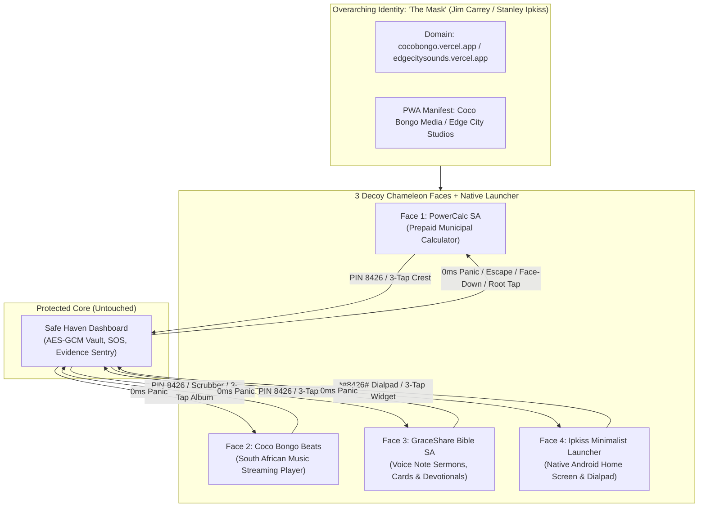
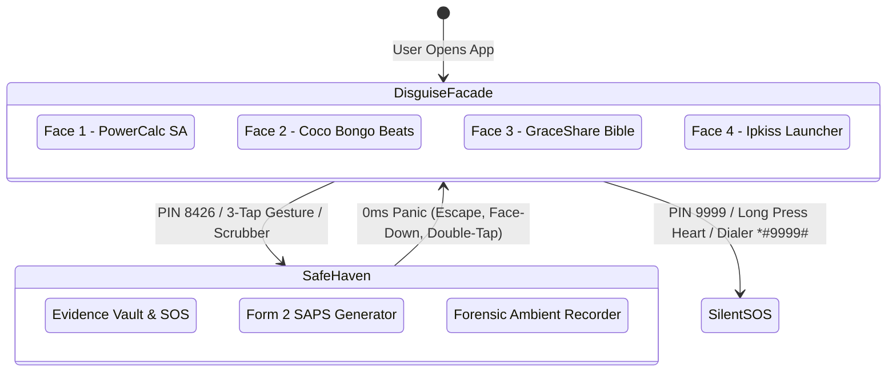

# Umkhuseli v2.6.0+ Chameleon Facades & Android Launcher Specification

> [!IMPORTANT]
> **Core Architectural Invariant**: The **Safe Haven** core (`SafeHavenDashboard.tsx`, AES-256 encrypted vault, Audio Sentry, SOS dispatch network, and legal affidavit engines) remains completely unchanged. All new features operate strictly as outer chameleon decoy layers (facades) that seamlessly drop into or restore from Safe Haven under the 0ms panic protocol.

---

## 1. Executive Summary & "The Mask" Thematic Identity

For **v2.6.0+**, the platform adopts an overarching meta-camouflage inspired by the 1994 film *The Mask* (starring Jim Carrey as Stanley Ipkiss). 

In the film, the Mask of Loki allows an ordinary, vulnerable person to don a powerful, invulnerable persona that can morph into any character, confound threats, and dance effortlessly through danger at the **Coco Bongo Club** in **Edge City**.



---

## 2. Domain & Vercel Deployment Architecture

### 2.1 Recommended Production & Decoy Domains

| Tier | Domain Name | Persona / Decoy Function | Thematic Connection |
| :--- | :--- | :--- | :--- |
| **Primary (Recommended)** | `cocobongo.vercel.app` | Music & Entertainment Streaming | The legendary nightclub in *The Mask* where Stanley dances and eludes the mob. Completely innocent in browser history. |
| **Alternative A** | `edgecitysounds.vercel.app` | South African Radio & Music Hub | Edge City is the municipal setting of *The Mask*. Perfect fusion of music and municipal context. |
| **Alternative B** | `ipkiss-media.vercel.app` | Multimedia & Utility Portal | Stanley Ipkiss's surname. Sounds like an accounting or indie software studio. |
| **Alternative C** | `cocobongo-fm.vercel.app` | Live Amapiano & Gospel Web Radio | Matches Face 2 (Music App) and Face 3 (Sermons) seamlessly. |

### 2.2 PWA Web App Manifest (`manifest.json`) Strategy
Depending on the user's active decoy selection in Settings, the PWA dynamically swaps its service worker title, theme color, and application icon:
- **PowerCalc**: Theme `#0F172A`, icon `Zap / Electricity Meter`
- **Coco Bongo Music**: Theme `#09090B`, icon `Music Note / Vinyl Disc`
- **GraceShare Bible**: Theme `#1E1B4B`, icon `Open Book / Golden Cross`
- **Ipkiss Launcher**: Theme `#18181B`, icon `Minimalist App Drawer Grid`

---

## 3. UI Planning & Architectural Blueprints

### Face 1: PowerCalc SA (Municipal Prepaid Calculator)

```
┌─────────────────────────────────────────────────────────┐
│ [Crest] City of Johannesburg • PowerCalc SA   [STS-6 Ready] │
├─────────────────────────────────────────────────────────┤
│ [Electricity]   [Water]   [Solar Calc]   [Tariff Guide] │
├─────────────────────────────────────────────────────────┤
│  VENDING PREPAID PURCHASE                               │
│  Meter Number: [ 04-2918-3819-2                 ]       │
│  Purchase Amount (ZAR): [ R200                  ]       │
│  Tariff Tier: [ Step 1 Residential (IBT) ▼      ]       │
│                                                         │
│  [ R50 ]  [ R100 ]  [ R200 ]  [ R500 ]  [ Custom ]      │
│                                                         │
│  [       CALCULATE ELECTRICITY TOKENS (STS)      ]      │
├─────────────────────────────────────────────────────────┤
│  VENDING TRANSACTION RECEIPT                            │
│  Estimated Units: 84.6 kWh • Net Cost: R173.91 (15% VAT)│
│  TOKEN: [ 4819 - 0281 - 9481 - 0294 - 8812 ]            │
└─────────────────────────────────────────────────────────┘
```
- **Current State**: Production-ready and refactored (<350 lines).
- **Triggers**:
  - `8426` in Amount or Meter -> Safe Haven unlock.
  - `9999` in Amount or Meter -> Silent duress SOS + STS Error 30 emulation.
  - 3-tap gesture on municipal crest -> Safe Haven unlock.

---

### Face 2: A Music-Centered App ("Coco Bongo Beats / Edge City Sounds")

An authentic, modern streaming player customized for South African audiences featuring Amapiano, Afro House, Gospel, and Maskandi playlists.

```
┌─────────────────────────────────────────────────────────┐
│ ≡  COCO BONGO BEATS        [ Search: "8426" 🔍 ]   [⚙]  │
├─────────────────────────────────────────────────────────┤
│  NOW PLAYING: Private School Amapiano Vol. 4            │
│  ┌───────────────────────────────────────────────────┐  │
│  │                                                   │  │
│  │        [ 🎵 Animated Spinning Album Art 🎵 ]       │  │
│  │              (Covert 3-Tap Sensor)                │  │
│  │                                                   │  │
│  └───────────────────────────────────────────────────┘  │
│  "Banyana Bafana (Summer Groove)"                       │
│  DJ Edge City ft. Coco Bongo All-Stars                  │
│                                                         │
│  02:45 ━━━━━━━━━━━━●──────────── 06:30                  │
│  [ 🔀 ]    [⏮]       [ ▶ / ⏸ ]       [⏭]      [ 🔁 ]   │
├─────────────────────────────────────────────────────────┤
│  FEATURED PLAYLISTS                                     │
│  • Top 50 Mzansi Deep House 2026 (12 tracks)           │
│  • Sunday Gospel Upliftment & Worship (24 tracks)       │
│  • Soweto Classic Kwaito & Jazz Lounge (18 tracks)      │
│  • Maskandi Guitar Legends (15 tracks)                  │
├─────────────────────────────────────────────────────────┤
│  [ Offline Cache: 48 Tracks Loaded (No Data Required) ] │
└─────────────────────────────────────────────────────────┘
```

#### Covert Triggers & Safety Interactions:
1. **Safe Haven Unlock**:
   - Typing `8426` into the track search bar and pressing enter or search icon.
   - 3 rapid taps on the spinning album art within 800 milliseconds.
   - Scrubbing the track playback slider specifically to `08:42` (8m 42s).
2. **Duress SOS Dispatch**:
   - Typing `9999` into the search bar dispatches silent SOS while pretending to search for tracks ("Track index #9999: Queued").
   - Long-pressing the "Favorite Heart" icon for 4 consecutive seconds.
3. **0ms Panic Camouflage**:
   - Instant drop from Safe Haven to Coco Bongo Beats: stops audio or switches to ambient lo-fi beat, scrubbing memory.

---

### Face 3: Bible Sharing App ("GraceShare SA / Izwi LeNkosi")

A faith-based devotional community app designed for sharing voice note sermons, inspirational verse images (for WhatsApp status), and multilingual scripture reflections.

```
┌─────────────────────────────────────────────────────────┐
│ ✝  IZWI LENKOSI • GRACE BIBLE   [ EN | ZU | ST ]   [🔍] │
├─────────────────────────────────────────────────────────┤
│  VERSE OF THE DAY (Psalm 91:1-2)                        │
│  "He who dwells in the secret place of the Most High    │
│   shall abide under the shadow of the Almighty..."      │
│  ┌───────────────────────────────────────────────────┐  │
│  │ [🖼 Scripture Image Card: Sunrise over Drakensberg]│  │
│  │ [ 📥 Download Image ]    [ 📤 Share to WhatsApp ] │  │
│  └───────────────────────────────────────────────────┘  │
├─────────────────────────────────────────────────────────┤
│  VOICE NOTE SERMONS (Izintshumayelo Zezwi)              │
│  ┌───────────────────────────────────────────────────┐  │
│  │ 👤 Pastor Mthembu — Soweto Fellowship             │  │
│  │ "Walking Through the Shadow Without Fear" (2:14)  │  │
│  │ [ ▶ Play ] ılılı.ıllı.ılılılı.lı.ıllı [ 1.5x ]    │  │
│  └───────────────────────────────────────────────────┘  │
│  ┌───────────────────────────────────────────────────┐  │
│  │ 👤 Rev. Khumalo — Durban Central Mission           │  │
│  │ "Strength in the Secret Place" (3:45)             │  │
│  │ [ ▶ Play ] ılılı.ıllı.ılılılı.lı.ıllı [ 1.0x ]    │  │
│  └───────────────────────────────────────────────────┘  │
├─────────────────────────────────────────────────────────┤
│  DAILY DEVOTIONAL REFLECTION                            │
│  "Today, hold firm knowing your safe refuge is unseen." │
│  [ Submit Community Prayer Request: [             ] ]  │
└─────────────────────────────────────────────────────────┘
```

#### Covert Triggers & Safety Interactions:
1. **Safe Haven Unlock**:
   - Typing `8426` into the Scripture search bar.
   - Entering `8426` in the "Submit Community Prayer Request" box.
   - Covert 3-tap gesture on the Cross icon in the header.
2. **Duress SOS Dispatch**:
   - Entering `9999` in the Prayer Request box silently fires SOS with prompt: *"Prayer request received. Our intercession team is praying for you."*
3. **Multilingual Authentic Text**:
   - Real scripture texts in English, isiZulu (*IBhayibheli Elingcwele*), and Sesotho (*Baebele e Halalelang*).

---

### Face 4: Native Android Launcher ("Ipkiss Minimalist Launcher")

For native APK / Android Capacitor packaging or web standalone full-screen home mode. Renders an authentic Android launcher interface.

```
┌─────────────────────────────────────────────────────────┐
│  14:32  •  Tue, 27 Oct  •  Johannesburg 22°C ⛅  🔋 88%  │
├─────────────────────────────────────────────────────────┤
│  [ G  Search Google or type URL...          🎤  📷 ]    │
├─────────────────────────────────────────────────────────┤
│                                                         │
│   [📞]          [💬]          [🟢]         [📷]        │
│   Phone       Messages      WhatsApp      Camera        │
│                                                         │
│   [⚡]          [🎵]          [✝]          [⚙]         │
│  PowerCalc   Coco Bongo    Grace Bible   Settings       │
│                                                         │
│   [📁]          [🗺]          [📻]         [🛡]        │
│  Gallery       Maps          Radio        Security      │
│                                                         │
├─────────────────────────────────────────────────────────┤
│  DOCK:                                                  │
│   [📞]          [💬]          [🌐]         [📷]        │
└─────────────────────────────────────────────────────────┘
```

#### Native Android Covert Actions:
1. **Dialpad Secret Code**:
   - Tapping the **Phone** icon opens a dialer modal.
   - Dialing `*#8426#` (or entering `8426` and pressing call) immediately opens **Safe Haven**.
   - Dialing `*#9999#` (or entering `9999` and pressing call) silently fires Duress SOS, displaying standard carrier message: `MMI code started > Call forwarding unconditional: Voice disabled`.
2. **Search Bar Entry**:
   - Typing `8426` into the launcher search bar opens Safe Haven.
   - Typing `9999` dispatches silent Duress SOS.
3. **App Launcher Dynamic Routing**:
   - Tapping `PowerCalc` opens Face 1.
   - Tapping `Coco Bongo` opens Face 2.
   - Tapping `Grace Bible` opens Face 3.
4. **Panic Home Action**:
   - Pressing Android hardware Back or Home instantly returns to the Launcher home screen with zero memory traces.

---

## 4. State Management Architecture (`disguiseManager.ts` v2.6.0)

```typescript
export type DisguiseType = 
  | 'MUNICIPAL_PREPAID'  // Face 1: PowerCalc SA
  | 'MUSIC_PLAYER'       // Face 2: Coco Bongo Beats (The Mask)
  | 'DAILY_DEVOTIONAL'   // Face 3: GraceShare Bible SA
  | 'ANDROID_LAUNCHER';  // Face 4: Ipkiss Minimalist Launcher

export interface DisguiseMetadata {
  id: DisguiseType;
  name: string;
  title: string;
  subtitle: string;
  icon: string;
  description: string;
  themeColor: string;
  defaultCovertPin: string;
  thematicReference: string;
}
```

### Disguise Switching Matrix



---

## 5. Non-Functional Invariants & Compliance Checklist

1. **Zero Safe Haven Disruption**:
   - `SafeHavenDashboard.tsx`, `encryptedVaultDb.ts`, `emergencySosService.ts`, and `deviceLocationResolver.ts` remain unchanged and fully functional.
2. **0ms Latency Panic Guarantee**:
   - All 4 facades implement instantaneous synchronous restoration without async animation locks.
3. **WCAG 2.1 AA Compliance**:
   - Minimum 4.5:1 text-to-background contrast ratio across all light/dark themes.
   - Fully accessible ARIA tags on music controls, audio scrubbers, and scripture cards.
4. **Zero Dead Buttons**:
   - Every play button, playlist item, scripture share button, and launcher icon triggers a realistic, authentic decoy behavior.
5. **No Data Leakage**:
   - Audio streams, scripture notes, and calculator entries do not mix with encrypted vault storage. Vault memory is completely isolated.
